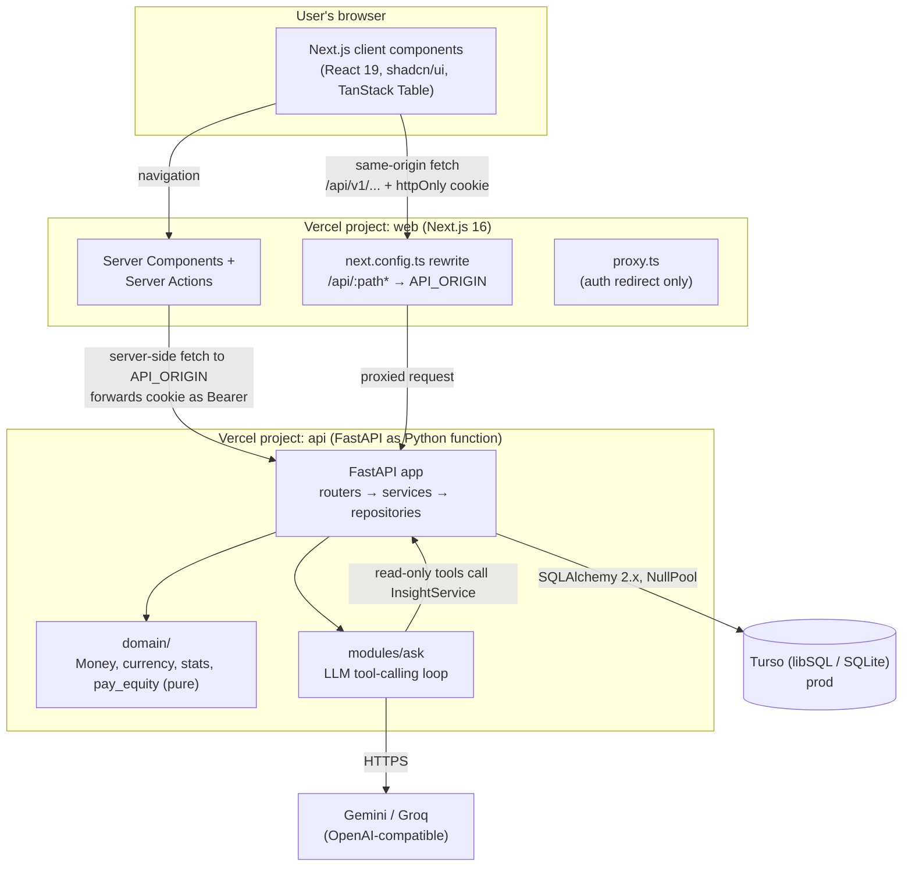
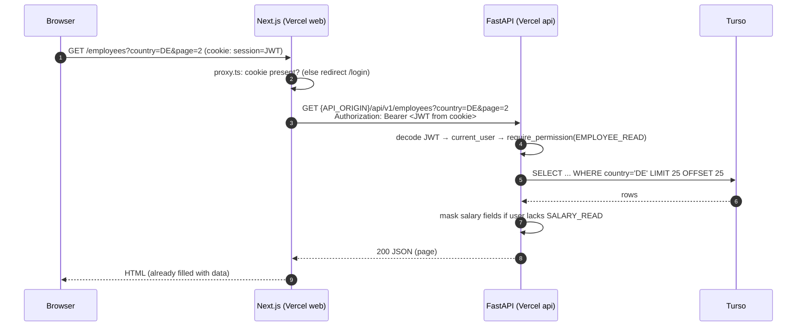
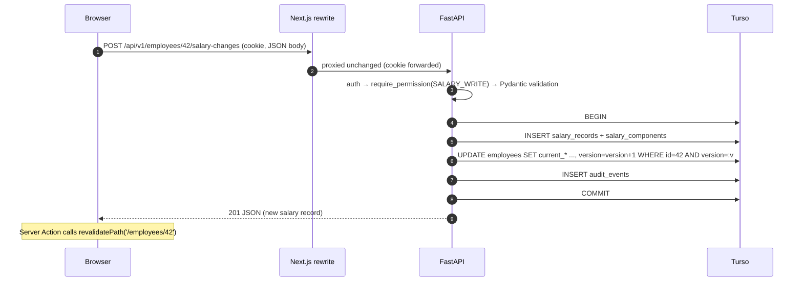
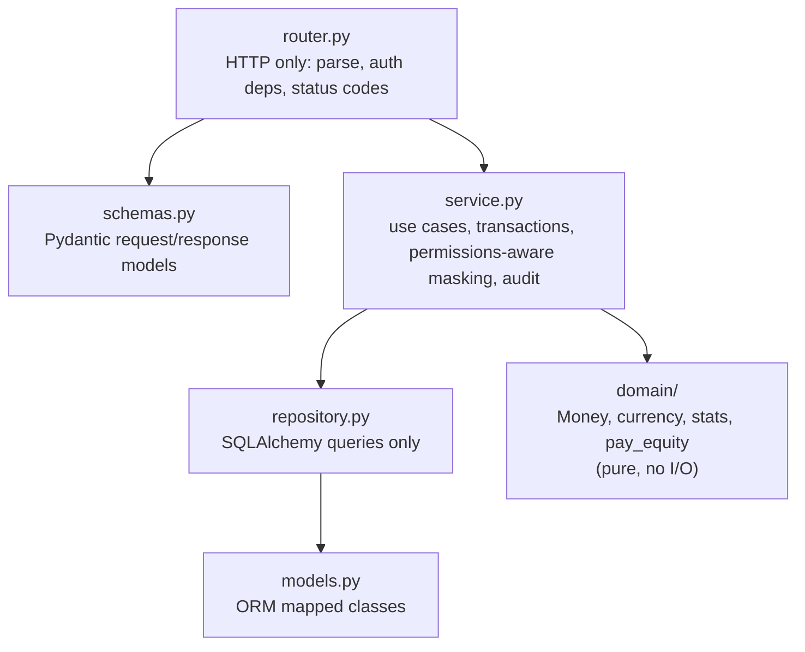

# 05 — Architecture

> How the system is structured: its parts, how they talk to each other, and why it is shaped this way.

**Status:** Draft for review · **Last updated:** 2026-10-24
**Related:** [01-prd.md](01-prd.md) · [06-data-model.md](06-data-model.md) · [07-api-spec.md](07-api-spec.md) · [08-security-rbac.md](08-security-rbac.md) · [17-deployment.md](17-deployment.md) · [19-performance.md](19-performance.md) · [20-trade-offs.md](20-trade-offs.md) · ADRs [0001](adr/0001-monorepo.md), [0002](adr/0002-sqlite-everywhere-turso.md), [0003](adr/0003-sync-sqlalchemy-serverless.md), [0008](adr/0008-fastapi-auth-same-origin-rewrite.md), [0016](adr/0016-deploy-vercel-turso.md)

---

## 1. Architectural goals

| Goal | How the architecture serves it |
|---|---|
| **Correct money handling** across about 10 countries and 9 currencies | Pure `domain/` layer (Money, currency exponents, stats) with no I/O, unit-tested first ([ADR 0004](adr/0004-money-integer-minor-units.md), [ADR 0007](adr/0007-pure-python-stats.md)) |
| **One source of truth for data and permissions** | FastAPI owns all business rules and authorization. Next.js only presents ([ADR 0008](adr/0008-fastapi-auth-same-origin-rewrite.md)) |
| **Fast, deterministic tests** | Layered design: domain tests need nothing, service tests use in-memory SQLite, API tests use FastAPI's TestClient. No network in CI |
| **Zero-setup for reviewers** | SQLite file locally, so no Docker and no database server. `make setup && make dev` |
| **$0 hosting that does not expire during review** | Vercel (web) + Vercel (API, Python functions) + Turso (hosted SQLite) ([ADR 0016](adr/0016-deploy-vercel-turso.md)) |
| **Easy to change** | Feature-sliced backend modules, contract-first typed frontend client ([ADR 0014](adr/0014-contract-first-openapi-client.md)), DB swappable by connection string ([ADR 0002](adr/0002-sqlite-everywhere-turso.md)) |
| **Judgment over complexity** | No message queues, caches, microservices or BFF service. Only what the 10k-employee problem needs |

---

## 2. System context (C4 level 1)

```mermaid
flowchart LR
    hr["👤 HR Manager<br/>(HR_MANAGER)"]
    admin["👤 HR Admin<br/>(ADMIN)"]
    viewer["👤 Finance / Leadership<br/>(VIEWER)"]

    sys["ACME Salary Management<br/>(web app)"]

    llm["LLM provider<br/>Gemini (default) / Groq<br/>OpenAI-compatible API"]
    excel["Excel / CSV files<br/>(current HR source of truth)"]

    hr -->|manage employees and salaries,<br/>import/export, ask questions| sys
    admin -->|users, FX rates, countries,<br/>audit log| sys
    viewer -->|aggregate insights,<br/>no individual pay| sys
    excel -->|bulk import CSV/XLSX| sys
    sys -->|export CSV/XLSX| excel
    sys -->|tool-calling requests<br/>(aggregates by default)| llm
```

External dependencies are deliberately minimal: one LLM provider (optional, behind a feature flag) and the files HR already uses.

---

## 3. Containers (C4 level 2)



| Container | Technology | Responsibility | Does **not** do |
|---|---|---|---|
| **Web** | Next.js 16 App Router, React 19, TS strict, Tailwind v4, shadcn/ui | Rendering, routing, URL-state filters (nuqs), forms (react-hook-form + zod), money **formatting** | Business rules, authorization decisions, money arithmetic |
| **API** | FastAPI, Pydantic v2, SQLAlchemy 2.x, Alembic, Python 3.13 | All business logic, validation, RBAC, masking, audit, insights, import/export, AI orchestration | Rendering |
| **Database** | SQLite (local file / `:memory:` in tests), Turso libSQL in prod | Persistence | Business logic (no triggers or stored procedures) |
| **LLM provider** | Gemini free tier (default), Groq free tier (alternative) | Turns a question plus tool results into an answer | Direct data access: it only ever sees tool outputs |

---

## 4. Request flows

### 4.1 Page load with data (Server Component)



### 4.2 Client mutation (same-origin through the rewrite)



Mutations can go through either a Server Action (which calls the API server-side) or a client fetch via the rewrite. Both reach the same FastAPI endpoint and the same permission check.

### 4.3 Same-origin authentication (login)

Why it is needed: `*.vercel.app` is on the Public Suffix List, so `acme-web.vercel.app` and `acme-api.vercel.app` are **different sites**. If the browser talked to the API directly, the session cookie would be a third-party cookie, which Safari and Firefox block by default. A single rewrite rule makes the API appear under the web origin.

```mermaid
sequenceDiagram
    autonumber
    participant B as Browser
    participant W as Next.js (acme-web.vercel.app)
    participant A as FastAPI (acme-api.vercel.app)
    participant D as Turso

    B->>W: POST /api/v1/auth/login {email, password} (client fetch, not a Server Action)
    W->>A: rewrite → POST /api/v1/auth/login
    A->>D: SELECT user WHERE email=?
    A->>A: pwdlib argon2 verify; check is_active
    A->>D: INSERT audit_events (auth.login)
    A-->>W: 200 {user, role, permissions}<br/>Set-Cookie: session=<JWT>; HttpOnly; Secure; SameSite=Lax; Path=/
    W-->>B: response passes through; the cookie is now stored for acme-web.vercel.app (first-party)
    B->>W: GET /insights (cookie sent automatically, same origin)
    W->>A: Server Component fetch with Authorization: Bearer <JWT>
```

Details live in [08-security-rbac.md](08-security-rbac.md) and [ADR 0008](adr/0008-fastapi-auth-same-origin-rewrite.md). Alternatives that were rejected (Bearer in localStorage, cross-site cookie, custom shared domain, static export served by FastAPI, hosted auth provider) are covered in [20-trade-offs.md](20-trade-offs.md).

### 4.4 AI "Ask about pay"

```mermaid
sequenceDiagram
    autonumber
    participant B as Browser
    participant A as AskService
    participant L as LLM (Gemini/Groq)
    participant T as Tool executor
    participant I as InsightService

    B->>A: POST /api/v1/ask {messages: last ~6 turns}
    A->>A: require_permission(ASK); rate-limit check (audit_events count)
    A->>A: build tool list filtered by user's permissions
    loop max 4 steps
        A->>L: chat.completions(messages, tools)
        L-->>A: tool_call(get_pay_by_group, {...}) or final answer
        A->>T: execute(tool, args)
        T->>T: re-check permission, validate enum args
        T->>I: same service the dashboard uses (masking + small-group rule)
        I-->>T: aggregates
        T-->>A: JSON tool result (treated as data)
    end
    A->>A: INSERT audit_events (ask.query, tools used)
    A-->>B: {answer, figures[], tool_calls[], caveats[]}
```

Full design: [10-ai-ask-design.md](10-ai-ask-design.md), [ADR 0015](adr/0015-ai-ask-tool-calling.md).

---

## 5. Backend layering



| Layer | Allowed to import | Forbidden | Tested by |
|---|---|---|---|
| `router` | schemas, service, `core.deps` | repositories, ORM models, raw SQL | API tests (TestClient) |
| `service` | repository, domain, other services' public functions, `core` | FastAPI `Request`/`Response`, HTTP status codes | Service tests (in-memory SQLite) |
| `repository` | models, SQLAlchemy | business rules, permission checks | Service/integration tests |
| `models` | SQLAlchemy | anything above | Migration tests |
| `domain` | stdlib only (`decimal`, `dataclasses`, `statistics` where exact) | DB, HTTP, config, time-of-day | Unit + Hypothesis property tests |

Rules (enforced by review and written into `CLAUDE.md`, see [16-claude-code-setup.md](16-claude-code-setup.md)):

1. **The transaction boundary is the service method.** One use case = one unit of work = one commit. Audit events are written in the same transaction ([ADR 0011](adr/0011-audit-events.md)).
2. **Permissions are checked in two places.** The router declares `Depends(require_permission(...))` for coarse access. The service applies field-level masking and the small-group rule, because the AI tool executor calls services directly ([ADR 0009](adr/0009-permission-rbac-small-group-rule.md)).
3. **Money never becomes a float.** Integers in minor units through every layer; `Decimal` only for FX conversion, inside `domain/money.py`.
4. **Code checks permissions, never role names.**

---

## 6. Module map

### 6.1 Backend (`backend/src/salary_api/`)

```
main.py                 app factory: routers, problem+json error handlers, request-id middleware, CORS (dev only)
openapi.py              `python -m salary_api.openapi <path>` writes the OpenAPI JSON (used by make api-sync)
core/
  config.py             pydantic-settings Settings (env-driven, validated; prod refuses default secrets)
  db.py                 engine/session factory; SQLite PRAGMAs; NullPool when APP_ENV=production
  models.py             DeclarativeBase with the constraint naming convention
  security.py           pwdlib (argon2) hashing, PyJWT encode/decode
  permissions.py        Permission enum + ROLE_PERMISSIONS map
  deps.py               get_session, current_user, require_permission(...)
  errors.py             domain exceptions → RFC 9457 problem+json
  request_id.py         X-Request-ID middleware (accept a safe incoming ID or make a UUID4)
  logging.py            structlog JSON config
domain/
  money.py              Money value object (amount_minor:int, currency:str), FX conversion with Decimal
  currency.py           ISO 4217 exponent table (JPY=0, USD=2, ...)
  stats.py              percentile/median/mean over sorted ints (pure)
  pay_equity.py         compa-ratio vs pay band, flags, rollups
modules/
  health/               GET /health (read-only DB check)
  auth/                 login, logout, me
  users/                admin user management
  reference/            countries, departments, job_roles (read for all; seeded; admin edit of countries)
  employees/            CRUD, search/filter/paginate, terminate/reactivate, optimistic lock
  salaries/             salary history, record salary change, components
  insights/             overview, by-department, by-job-title, distribution, department-cost, top-earners, raises, pay-equity
  fx/                   FX rates (admin)
  imports/              parsers (csv, xlsx) → validator → dry-run → commit
  exports/              CSV/XLSX writers (formula-safe, role-aware columns)
  audit/                audit event writer + admin query
  ask/                  LLMClient interface, OpenAI-compatible adapter, tool registry, executor, AskService
seed/
  seed_config.py        countries, departments, roles, bands, distributions (data only)
  generator.py          deterministic generator (random.Random(seed), Faker per locale)
  cli.py                `python -m salary_api.seed --seed 42 --employees 10000 --reset`
```

Each `modules/<feature>/` folder contains `router.py`, `schemas.py`, `service.py`, `repository.py` and `models.py` (only the files it needs).

### 6.2 Frontend (`frontend/src/`)

```
app/
  (auth)/login/
  (app)/layout.tsx          app shell: nav, role-aware menu
  (app)/employees/          list, new, [id], import
  (app)/insights/           overview, pay-equity
  (app)/ask/
  (app)/admin/              users, fx-rates, countries, audit
lib/
  api/schema.d.ts           GENERATED by openapi-typescript (never hand-edited)
  api/client.ts             openapi-fetch client (browser: relative /api, server: API_ORIGIN + cookie forwarding)
  money.ts                  Intl.NumberFormat formatting driven by currency exponent
  permissions.ts            UI-only helpers (hide buttons); not security
components/                 shadcn/ui + feature components
proxy.ts                    redirect unauthenticated users to /login (Next 16 replacement for middleware)
```

See [13-frontend-ux.md](13-frontend-ux.md) for screens and [ADR 0014](adr/0014-contract-first-openapi-client.md) for the client generation.

---

## 7. Serverless constraints (FastAPI on Vercel)

| Constraint | Impact | Mitigation |
|---|---|---|
| Stateless, short-lived function instances | No in-memory sessions, caches or rate-limit counters | JWT sessions; rate limits counted from `audit_events`; import dry-run results stored in `import_jobs` |
| No persistent filesystem (read-only except `/tmp`) | SQLite file cannot live in the function | Turso (hosted libSQL) in prod ([ADR 0002](adr/0002-sqlite-everywhere-turso.md)) |
| Connection pools do not survive invocations | Pooling wastes connections | `NullPool` in serverless mode ([ADR 0003](adr/0003-sync-sqlalchemy-serverless.md)) |
| 4.5 MB request/response body limit | Large exports or imports could fail | 10k-row CSV export is about 1 MB, XLSX about 600 KB; import upload capped at 4 MB (10k-row CSV is about 1.5 MB) |
| Cold starts (about 1–2 s) | First request after idle is slower | Lean imports at module load; Turso in the same region as the function ([19-performance.md](19-performance.md)) |
| Max execution time (Hobby: 300 s) | Long tasks impossible | Nothing long runs in a request; migrations and seeding run from CI or locally |
| Migrations | Must not run inside a request | `alembic upgrade head` from CI/local against Turso ([17-deployment.md](17-deployment.md)) |

---

## 8. Configuration and environment

All configuration comes from environment variables, validated at startup by `pydantic-settings`. **In production the app refuses to start** if secrets are missing or left at their development defaults.

### 8.1 API (`backend/.env.example`)

| Variable | Example (dev) | Prod | Notes |
|---|---|---|---|
| `APP_ENV` | `development` (`test` in CI) | `production` | Switches strict checks (secure cookies, no defaults). Values per the [glossary](glossary.md) §7 |
| `DATABASE_URL` | `sqlite:///./dev.db` | `sqlite+libsql://<db>.turso.io?secure=true` (no token in the URL) | The only thing that changes to switch DB; Postgres fallback `postgresql+psycopg://...` |
| `DATABASE_AUTH_TOKEN` | — | Turso token (secret) | Passed via connect args, never logged |
| `JWT_SECRET` | `dev-only-change-me` | random ≥32 bytes (secret) | Prod rejects placeholders and anything shorter than 32 bytes |
| `JWT_TTL_MINUTES` | `480` **(proposed)** | `480` **(proposed)** | Session length, see [08-security-rbac.md](08-security-rbac.md) |
| `COOKIE_SECURE` | `false` | `true` | Forced `true` in production |
| `CORS_ORIGINS` | `http://localhost:3000` | empty | Comma-separated. CORS is off when empty; not needed in prod (same origin via rewrite) |
| `LLM_BASE_URL` | Gemini OpenAI-compatible endpoint | same or Groq | Feature flag: Ask is disabled when `LLM_API_KEY` is empty |
| `LLM_MODEL` | Gemini Flash-class model **(TBD exact id at build time)** | same | |
| `LLM_API_KEY` | empty | secret | |
| `ASK_RATE_LIMIT_PER_HOUR` | `20` | `20` | Per user |
| `ASK_MAX_STEPS` | `4` | `4` | Tool steps per question |
| `SEED_ADMIN_PASSWORD` / `SEED_HR_PASSWORD` / `SEED_VIEWER_PASSWORD` | dev values | demo values (secret) | Seed only |
| `LOG_LEVEL` | `DEBUG` | `INFO` | |

### 8.2 Web (`frontend/.env.example`)

| Variable | Example | Notes |
|---|---|---|
| `API_ORIGIN` | `http://localhost:8000` | Used by the rewrite destination and by server-side fetches. Never exposed to the browser |

The browser never needs the API's address: it always calls the relative path `/api/v1/...`.

---

## 9. Cross-cutting concerns

| Concern | Approach |
|---|---|
| **Errors** | Domain exceptions in `core/errors.py` (`Unauthenticated`, `Forbidden`, `NotFound`, `VersionConflict`, `Duplicate`, `InvalidState`, `ValidationFailed`, `ServiceUnavailable`) map to RFC 9457 `application/problem+json` ([07-api-spec.md](07-api-spec.md)) |
| **Logging** | structlog JSON; every log line carries `request_id` (from a safe `X-Request-ID` header, at most 128 of `[A-Za-z0-9._-]`, or a new UUID4). Tracebacks without frame locals. No bodies, salary amounts or passwords in logs |
| **Observability** | Vercel function logs; `/api/v1/health` runs a read-only DB check (`SELECT 1`) |
| **Time** | All timestamps UTC (`datetime` with tz). Dates (`hire_date`, `effective_date`) are plain dates. Tests freeze the clock with time-machine |
| **IDs** | Integer surrogate primary keys internally; `employee_code` (`ACME-004217`) is the human-facing identifier |
| **Versioning** | URL prefix `/api/v1` |
| **Validation** | Pydantic at the edge (shape, ranges, enums); service-level rules (e.g. currency exponent, salary > 0, job role exists) in services/domain |

---

## 10. What is deliberately not in the architecture

| Not included | Why |
|---|---|
| Separate BFF service | One rewrite rule gives the same-origin benefit with no extra code to run |
| Message queue / background workers | No long-running jobs at this scale; import of 10k rows runs within a request |
| Cache layer (Redis etc.) | Insight queries over 10k rows take milliseconds ([19-performance.md](19-performance.md)) |
| Microservices | One bounded context; one deployable API is easier to reason about and test |
| Async SQLAlchemy | Light CRUD; sync is simpler to test and has no event-loop pitfalls ([ADR 0003](adr/0003-sync-sqlalchemy-serverless.md)) |
| Database-level logic (triggers, views) | Keeps behaviour in tested Python and portable between SQLite and Postgres |
