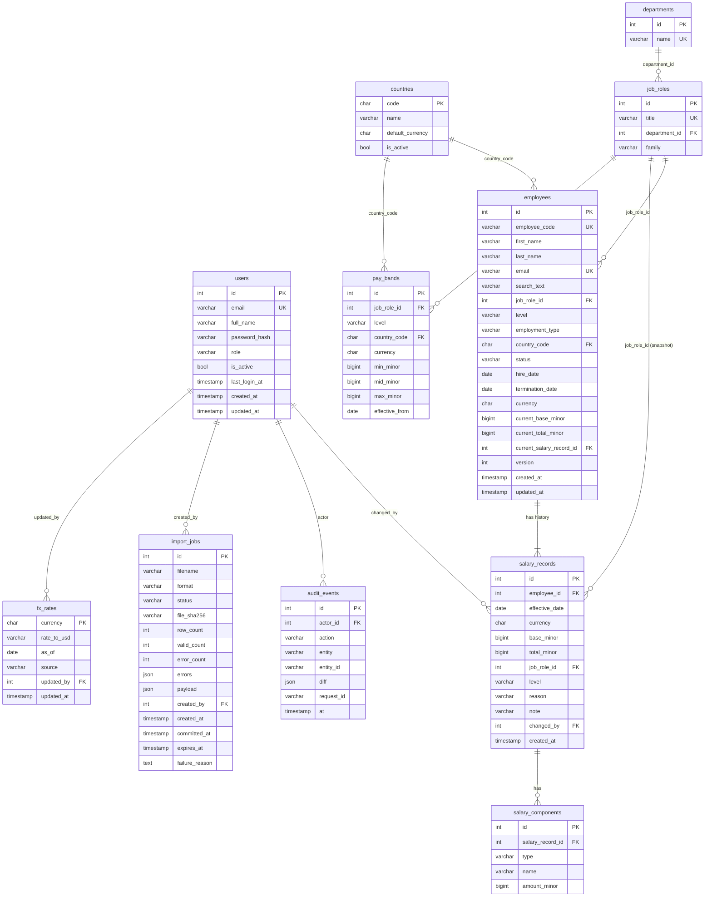

# 06 — Data Model

> Every table, column, constraint and index, plus the money, FX and history rules the schema enforces.

**Status:** Draft for review · **Last updated:** 2026-10-24
**Related:** [05-architecture.md](05-architecture.md) · [07-api-spec.md](07-api-spec.md) · [09-insights-pay-equity.md](09-insights-pay-equity.md) · [11-import-export.md](11-import-export.md) · [12-seed-data.md](12-seed-data.md) · [19-performance.md](19-performance.md) · ADRs [0002](adr/0002-sqlite-everywhere-turso.md), [0004](adr/0004-money-integer-minor-units.md), [0005](adr/0005-fx-read-time-conversion.md), [0006](adr/0006-append-only-salary-history.md), [0010](adr/0010-compensation-components.md), [0011](adr/0011-audit-events.md), [0012](adr/0012-bulk-import-dry-run.md), [0013](adr/0013-soft-delete-optimistic-locking.md)

---

## 1. Design principles

1. **Money is an integer count of minor units plus an ISO 4217 code.** Never a float, never a DECIMAL column (SQLite has no true DECIMAL) ([ADR 0004](adr/0004-money-integer-minor-units.md)).
2. **Converted amounts are never stored.** USD values are computed when read, using `fx_rates`, and returned with the rate's `as_of` date ([ADR 0005](adr/0005-fx-read-time-conversion.md)).
3. **Salary history is append-only.** A salary change inserts a new `salary_records` row. Existing rows are never updated or deleted ([ADR 0006](adr/0006-append-only-salary-history.md)).
4. **Current salary is denormalized onto `employees`**, written in the same transaction as the new salary record. Lists and insights then read one table.
5. **Controlled vocabularies** (departments, job roles, countries) are tables, so pay-equity cohorts cannot fragment through spelling variants.
6. **Data minimization.** No date of birth, gender, address, bank details or manager. No pay question in scope needs them ([01-prd.md](01-prd.md)).
7. **Portable schema.** Only types and constraints that behave identically on SQLite/libSQL and Postgres. Enums are stored as `VARCHAR` + `CHECK` (SQLAlchemy `native_enum=False`).
8. **Soft delete only.** Employees are terminated, never deleted ([ADR 0013](adr/0013-soft-delete-optimistic-locking.md)).

---

## 2. Entity-relationship diagram



---

## 3. Conventions

| Convention | Rule |
|---|---|
| Primary keys | `id INTEGER` surrogate (auto-increment) unless a natural key is stable (`countries.code`, `fx_rates.currency`) |
| Timestamps | `created_at` / `updated_at` as timezone-aware UTC (`DateTime(timezone=True)`); set by the application, not DB defaults, so tests can freeze time |
| Dates | `DATE` for business dates (`hire_date`, `effective_date`, `as_of`) |
| Money columns | Suffix `_minor`, type `BIGINT`, always paired with a `currency` column in the same row |
| Enum columns | `VARCHAR(n)` + `CHECK (col IN (...))`, generated by SQLAlchemy `Enum(..., native_enum=False, create_constraint=True)` |
| JSON columns | SQLAlchemy `JSON` (TEXT on SQLite/libSQL, `JSON` on Postgres) |
| Naming | snake_case, plural table names; constraint names follow a SQLAlchemy `naming_convention` (`pk_`, `fk_`, `uq_`, `ck_`, `ix_`) so Alembic diffs are stable |
| Lengths | Values marked **(proposed)** are sensible defaults to confirm during milestone 4 |

---

## 4. Tables

### 4.1 `users`

Application users (HR staff). Employees are **not** users; there is no self-service ([01-prd.md](01-prd.md)).

| Column | Type | Null | Constraint / default | Notes |
|---|---|---|---|---|
| `id` | INTEGER | no | PK | |
| `email` | VARCHAR(254) | no | UNIQUE | Stored lowercased; login identifier |
| `full_name` | VARCHAR(120) **(proposed)** | no | | |
| `password_hash` | VARCHAR(255) | no | | pwdlib argon2 encoded hash; never returned by the API |
| `role` | VARCHAR(20) | no | CHECK IN (`ADMIN`, `HR_MANAGER`, `VIEWER`) | Mapped to permissions in code ([08-security-rbac.md](08-security-rbac.md)) |
| `is_active` | BOOLEAN | no | default `true` | Inactive users cannot log in; tokens rejected at next request |
| `last_login_at` | TIMESTAMP tz | yes | | |
| `created_at`, `updated_at` | TIMESTAMP tz | no | | |

Indexes: `uq_users_email`.

### 4.2 `countries`

| Column | Type | Null | Constraint | Notes |
|---|---|---|---|---|
| `code` | CHAR(2) | no | PK | ISO 3166-1 alpha-2 (`US`, `IN`, `DE`, ...) |
| `name` | VARCHAR(80) | no | | Display name |
| `default_currency` | CHAR(3) | no | CHECK value is a supported ISO 4217 code (validated in the service) | Every salary of an employee in this country uses this currency (enforced by the salary service). Salaries in another currency (expat pay) are out of scope for v1 |
| `is_active` | BOOLEAN | no | default `true` | Inactive countries are hidden from forms and import |

Seeded with 10 countries ([12-seed-data.md](12-seed-data.md)). Admins can edit `name`, `default_currency` and `is_active` (`REFERENCE_ADMIN`).

### 4.3 `departments`

| Column | Type | Null | Constraint |
|---|---|---|---|
| `id` | INTEGER | no | PK |
| `name` | VARCHAR(60) **(proposed)** | no | UNIQUE |

Seeded (9 departments). No admin edit UI in scope.

### 4.4 `job_roles`

The **controlled list of job titles**. Forms and imports validate against it so that "Sr Engineer" and "Senior Engineer" cannot become two cohorts.

| Column | Type | Null | Constraint | Notes |
|---|---|---|---|---|
| `id` | INTEGER | no | PK | |
| `title` | VARCHAR(80) **(proposed)** | no | UNIQUE | e.g. `Software Engineer` |
| `department_id` | INTEGER | no | FK → `departments.id` | A role belongs to exactly one department |
| `family` | VARCHAR(30) **(proposed)** | no | CHECK IN (family list) | Pay family used by seed band multipliers, e.g. `ENGINEERING`, `SALES`, `G_AND_A` (final list in [12-seed-data.md](12-seed-data.md)) |

Indexes: `uq_job_roles_title`, `ix_job_roles_department_id`. 35 seeded rows ([12-seed-data.md](12-seed-data.md) §3). No admin edit UI in scope.

Department is derived through `job_role → department`; `employees` does not store `department_id` separately (avoids two sources of truth). Department filters join through `job_roles` (indexed).

### 4.5 `employees`

| Column | Type | Null | Constraint / default | Notes |
|---|---|---|---|---|
| `id` | INTEGER | no | PK | Internal |
| `employee_code` | VARCHAR(12) | no | UNIQUE; format `ACME-\d{6}` (validated in service) | Human-facing ID used for search and import duplicate detection |
| `first_name` | VARCHAR(100) | no | | Unicode (e.g. `José`, `Müller`, `佐藤`) |
| `last_name` | VARCHAR(100) | no | | |
| `email` | VARCHAR(254) | no | UNIQUE | Work email, stored lowercased; seed uses the reserved `acme.example` domain |
| `search_text` | VARCHAR(600) | no | | Derived, see §6.4 |
| `job_role_id` | INTEGER | no | FK → `job_roles.id` | |
| `level` | VARCHAR(2) | no | CHECK IN (`L1`..`L6`) | L1 Associate · L2 Mid · L3 Senior · L4 Lead/Staff · L5 Principal · L6 Director |
| `employment_type` | VARCHAR(12) | no | CHECK IN (`FULL_TIME`, `PART_TIME`, `CONTRACTOR`) | Insights default to `FULL_TIME` |
| `country_code` | CHAR(2) | no | FK → `countries.code` | |
| `status` | VARCHAR(10) | no | CHECK IN (`ACTIVE`, `TERMINATED`), default `ACTIVE` | |
| `hire_date` | DATE | no | | |
| `termination_date` | DATE | yes | CHECK `(status = 'TERMINATED') = (termination_date IS NOT NULL)`; CHECK `termination_date >= hire_date` | |
| `currency` | CHAR(3) | no | | Currency of the current salary; always the country's `default_currency` |
| `current_base_minor` | BIGINT | no | CHECK `> 0` | Denormalized from the current salary record |
| `current_total_minor` | BIGINT | no | CHECK `>= current_base_minor` | base + sum(components) |
| `current_salary_record_id` | INTEGER | yes* | FK → `salary_records.id` | *Nullable only for the instant inside the creating transaction (the employee row must exist before its first salary record). The service guarantees it is set before commit; an integration test asserts no committed employee has it null |
| `version` | INTEGER | no | default `1` | Optimistic locking: every update does `WHERE id=? AND version=?` and increments it ([ADR 0013](adr/0013-soft-delete-optimistic-locking.md)) |
| `created_at`, `updated_at` | TIMESTAMP tz | no | | |

Indexes (see [19-performance.md](19-performance.md) for the reasoning):

| Index | Columns | Serves |
|---|---|---|
| `uq_employees_employee_code` | `employee_code` | Lookup by ID, import dupes |
| `uq_employees_email` | `email` | Import dupes, uniqueness |
| `ix_employees_country_status` | `country_code, status` | Country filter, per-country insights |
| `ix_employees_job_role_level` | `job_role_id, level` | Designation/level filters, pay-equity cohorts |
| `ix_employees_status_employment_type` | `status, employment_type` | Default insight population (active full-time) |
| `ix_employees_currency_base` | `currency, current_base_minor` | Salary-range filter within one currency, top/bottom earners |
| `ix_employees_last_first` | `last_name, first_name` | Default sort |
| `ix_employees_search_text` | `search_text` | Prefix search (`LIKE 'term%'`); infix search scans, which is acceptable at 10k |

### 4.6 `salary_records` (append-only)

One row per salary event: hire, promotion, merit raise, market adjustment, correction.

| Column | Type | Null | Constraint | Notes |
|---|---|---|---|---|
| `id` | INTEGER | no | PK | Also breaks ties between same-day records |
| `employee_id` | INTEGER | no | FK → `employees.id` | |
| `effective_date` | DATE | no | | Service rules: `>= employees.hire_date`, `<= today` (no future-dated changes), `>=` the employee's latest existing `effective_date` |
| `currency` | CHAR(3) | no | | The employee's country currency at that time. Only a relocation (a country change, recorded as a salary change) changes it |
| `base_minor` | BIGINT | no | CHECK `> 0` | Annual base in minor units |
| `total_minor` | BIGINT | no | CHECK `>= base_minor` | Derived at write time: base + sum(components). Stored so history needs no re-aggregation |
| `job_role_id` | INTEGER | no | FK → `job_roles.id` | **Snapshot** of the role at that moment |
| `level` | VARCHAR(2) | no | CHECK IN (`L1`..`L6`) | **Snapshot**. Lets history show "L2 → L3, Promotion, +12%" |
| `reason` | VARCHAR(20) | no | CHECK IN (`HIRE`, `PROMOTION`, `MERIT`, `MARKET_ADJUSTMENT`, `CORRECTION`) | |
| `note` | VARCHAR(500) | yes | | Free-text justification |
| `changed_by` | INTEGER | yes | FK → `users.id` | Null only for seeded history |
| `created_at` | TIMESTAMP tz | no | | |

Indexes: `ix_salary_records_employee_effective` on `(employee_id, effective_date, id)` (history timeline, current record); `ix_salary_records_effective_reason` on `(effective_date, reason)` (raise statistics by period).

**Ordering rule:** the current record is the one with the greatest `(effective_date, id)`. Because future dates are rejected, the latest record is always the current one, which is what makes the denormalization in §6.2 safe.

**Immutability:** repositories expose no update or delete for this table. A wrong entry is fixed by appending a `CORRECTION` record.

### 4.7 `salary_components`

Allowances and bonus targets attached to one salary record ([ADR 0010](adr/0010-compensation-components.md)).

| Column | Type | Null | Constraint | Notes |
|---|---|---|---|---|
| `id` | INTEGER | no | PK | |
| `salary_record_id` | INTEGER | no | FK → `salary_records.id` | Same currency as the parent record (enforced in the service) |
| `type` | VARCHAR(20) | no | CHECK IN (`ALLOWANCE`, `BONUS_TARGET`) | |
| `name` | VARCHAR(60) **(proposed)** | no | | e.g. `HRA`, `Special allowance`, `Meal`, `Transport`, `Target bonus` |
| `amount_minor` | BIGINT | no | CHECK `>= 0` | Annual amount. The UI may let users enter a bonus as a % of base; the API stores the resulting amount |

Unique: `uq_salary_components_record_type_name` on `(salary_record_id, type, name)`.
Index: `ix_salary_components_record` on `salary_record_id`.

Out of scope, so there is no component type for them: equity/RSUs, commission, overtime, benefits ([02-requirements-one-pager.md](02-requirements-one-pager.md)).

### 4.8 `fx_rates`

| Column | Type | Null | Constraint | Notes |
|---|---|---|---|---|
| `currency` | CHAR(3) | no | PK | One current rate per currency |
| `rate_to_usd` | VARCHAR(32) | no | Must parse as a positive `Decimal` (service) | **USD per 1 major unit** of `currency`, stored as a decimal string (e.g. `"0.01198"` for INR) so no precision is lost on SQLite |
| `as_of` | DATE | no | | Shown with every converted figure |
| `source` | VARCHAR(80) | no | | e.g. `Static snapshot (illustrative)` |
| `updated_by` | INTEGER | yes | FK → `users.id` | |
| `updated_at` | TIMESTAMP tz | no | | |

The USD row exists with `rate_to_usd = "1"`. Changing a rate changes **current** USD views only. Nothing stored depends on it, and the change is recorded in `audit_events` (old/new rate). Rate history beyond the audit trail is out of scope ([03-clarifications.md](03-clarifications.md)).

### 4.8a `pay_bands`

The benchmark for pay equity. Compa-ratio = employee base ÷ `mid_minor` ([09-insights-pay-equity.md](09-insights-pay-equity.md) §3.8). Benchmarking against a band, rather than the cohort's own median, is what lets a team-wide gap show up.

| Column | Type | Null | Constraint | Notes |
|---|---|---|---|---|
| `id` | INTEGER | no | PK | |
| `job_role_id` | INTEGER | no | FK → `job_roles.id` | |
| `level` | VARCHAR(2) | no | CHECK IN (`L1`…`L6`) | |
| `country_code` | CHAR(2) | no | FK → `countries.code` | |
| `currency` | CHAR(3) | no | | The country's default currency |
| `min_minor` | BIGINT | no | CHECK > 0 | Seeded as 0.8 × mid |
| `mid_minor` | BIGINT | no | CHECK ≥ min | Seeded from the pre-noise reference formula ([12-seed-data.md](12-seed-data.md) §5) |
| `max_minor` | BIGINT | no | CHECK ≥ mid | Seeded as 1.2 × mid |
| `effective_from` | DATE | no | | `2026-01-01` **(proposed)** |

- Unique `(job_role_id, level, country_code, effective_from)`. The current band is the latest `effective_from` ≤ today.
- About 1,360 rows (each of the 35 roles' allowed levels × 10 countries). Read-only in v1. Editing (with `REFERENCE_ADMIN` + audit) is future work.
- An employee whose combination has no band gets `compa_ratio: null` (`no_band: true`). Seed data guarantees full coverage, and a test asserts it.

### 4.9 `audit_events` (append-only)

| Column | Type | Null | Constraint | Notes |
|---|---|---|---|---|
| `id` | INTEGER | no | PK | |
| `actor_id` | INTEGER | yes | FK → `users.id` | Null for system actions (seed, migrations) and failed logins with an unknown email |
| `action` | VARCHAR(60) | no | | Dotted verb, e.g. `employee.update`, `salary.change`, `export.download`, `ask.query` (full list in [08-security-rbac.md](08-security-rbac.md)) |
| `entity` | VARCHAR(40) | no | | e.g. `employee`, `user`, `fx_rate`, `import_job` |
| `entity_id` | VARCHAR(40) | yes | | String, so it fits integer IDs, currency codes and country codes |
| `diff` | JSON | yes | | `{"field": [old, new], ...}` for updates; contextual payload for other actions (filters used for an export, tools called for an ask). **Never contains password hashes or tokens** |
| `request_id` | VARCHAR(64) | yes | | Correlates with logs |
| `at` | TIMESTAMP tz | no | | |

Indexes: `ix_audit_events_at` on `at` (admin log, newest first); `ix_audit_events_actor_action_at` on `(actor_id, action, at)` (per-user Ask rate limit, user activity); `ix_audit_events_entity` on `(entity, entity_id)` (history of one record).

Written by services **in the same transaction** as the change it describes ([ADR 0011](adr/0011-audit-events.md)). If the change rolls back, so does its audit row.

### 4.10 `import_jobs`

Holds a dry-run result between "preview" and "commit", because serverless functions keep no state between requests ([ADR 0012](adr/0012-bulk-import-dry-run.md), [11-import-export.md](11-import-export.md)).

| Column | Type | Null | Constraint | Notes |
|---|---|---|---|---|
| `id` | INTEGER | no | PK | |
| `filename` | VARCHAR(255) | no | | Original name, for display only (never used as a path) |
| `format` | VARCHAR(4) | no | CHECK IN (`CSV`, `XLSX`) | |
| `status` | VARCHAR(10) | no | CHECK IN (`DRY_RUN`, `COMMITTED`, `FAILED`, `EXPIRED`) | |
| `file_sha256` | CHAR(64) | no | | Detects re-uploading the same file |
| `row_count` | INTEGER | no | | |
| `valid_count` | INTEGER | no | | |
| `error_count` | INTEGER | no | | |
| `errors` | JSON | no | | `[{row, column, code, message}]` |
| `payload` | JSON | yes | | Normalized, validated rows; cleared 7 days after the job ends **(proposed)** (it contains salary data) |
| `created_by` | INTEGER | no | FK → `users.id` | Only the creator (or an ADMIN) may commit |
| `created_at` | TIMESTAMP tz | no | | |
| `committed_at` | TIMESTAMP tz | yes | | |
| `expires_at` | TIMESTAMP tz | no | | `created_at` + 24 h **(proposed)** |
| `failure_reason` | TEXT | yes | | Set when status becomes `FAILED` |

Commit rules: status must be `DRY_RUN`; `error_count` must be 0; `expires_at` must not have passed (24 h, **proposed**), otherwise it becomes `EXPIRED`. Duplicate checks run **again** at commit time (data may have changed since the preview). All rows are inserted in one transaction; any failure rolls back everything and marks the job `FAILED`.

---

## 5. Money and FX rules

### 5.1 Representation

| Rule | Detail |
|---|---|
| Amount | `amount_minor: int`: the count of the currency's smallest unit (cents for USD, paise for INR, yen for JPY) |
| Exponent | From the ISO 4217 table in `domain/currency.py`: USD/EUR/GBP/INR/CAD/AUD/SGD/BRL = 2, JPY = 0 |
| Pairing | Every `*_minor` column has a `currency` in the same row (salary components inherit from their parent record) |
| Period | All stored amounts are **annual**. Monthly is presentation only (÷ 12, rounded half-even for display) |
| Validation | An input with more decimals than the currency allows is **rejected**, not rounded (e.g. `¥1,000.5`) |
| Arithmetic | Integer addition only (totals). Division and ratios happen in `domain/` with `Decimal` and explicit rounding |

### 5.2 Conversion to USD (read time only)

```
major_amount = Decimal(amount_minor) / 10 ** exponent(currency)
usd_major    = major_amount * Decimal(rate_to_usd)
usd_minor    = round_half_even(usd_major * 100)
```

- Conversion happens in `domain/money.py`, never in SQL and never in the frontend.
- Every API response containing a USD figure includes `fx_as_of` (the oldest `as_of` among the rates used) ([07-api-spec.md](07-api-spec.md)).
- Statistics within one country are computed in **local currency**. Cross-country comparisons use USD. Mixed-currency sums in local units are never produced ([09-insights-pay-equity.md](09-insights-pay-equity.md)).

---

## 6. Behavioural rules the schema supports

### 6.1 Salary history

- Creating an employee writes the `employees` row **and** a `HIRE` salary record (plus components) in one transaction.
- Recording a change appends a record with a `reason`, and may change `job_role_id`/`level` (promotion) and the employee's current role and level together.
- The history endpoint returns records ordered by `(effective_date, id)` with computed deltas (`base_change_pct`, previous level → new level).

### 6.2 Current-salary denormalization

On every salary write, inside the same transaction:

```
employees.current_salary_record_id = new_record.id
employees.current_base_minor       = new_record.base_minor
employees.current_total_minor      = new_record.total_minor
employees.currency                 = new_record.currency
employees.country_code             = new country                     (relocation only; currency must be that country's)
employees.job_role_id, level       = new_record.job_role_id, level   (if changed)
employees.version                  = version + 1
```

An integration test asserts the invariant for every employee after the seed and after random sequences of changes: the denormalized columns equal the latest salary record.

### 6.3 Termination and reactivation

- Terminate: `status=TERMINATED`, `termination_date` set (defaults to today, must be ≥ `hire_date`). Salary history is kept.
- Reactivate: `status=ACTIVE`, `termination_date=NULL`. Both bump `version` and write an audit event.
- Insights include only `ACTIVE` employees by default.

### 6.4 Search text

`search_text` is maintained by the service on create/update:

```
search_text = fold(f"{first_name} {last_name} {employee_code} {email}")
fold(s)     = NFKD-normalize → strip combining marks → casefold
```

- SQLite's `LIKE` is case-insensitive only for ASCII, so `Müller` would not match `müller` with plain `LIKE`. Folding in Python makes search behave the same on SQLite, libSQL and Postgres.
- Accent stripping is **decided**: `muller` also finds `Müller`, and `jose` finds `José`.
- The query term goes through the same `fold()`, then `search_text LIKE '%term%'`, with `%` and `_` escaped.
- Romanized names for Japanese employees appear in `email`, so searching `sato` finds `佐藤`'s record through the email part.

---

## 7. SQLite / libSQL specifics

| Topic | Handling |
|---|---|
| Foreign keys are off by default | `PRAGMA foreign_keys=ON` on every connection (SQLAlchemy `connect` event). A test asserts an orphan insert fails |
| Concurrency | `PRAGMA journal_mode=WAL` for local file databases; Turso manages its own journaling |
| Busy timeout | `PRAGMA busy_timeout=5000` **(proposed)** locally, to absorb short write locks |
| No DECIMAL | Money as integers; FX rate as a decimal string |
| `BIGINT` | Stored as SQLite INTEGER (64-bit signed); the largest annual salary in minor units (e.g. ¥100,000,000 = 1e8, or ₹10 crore = 1e10 paise) is far below 9.2e18 |
| Booleans | Stored as 0/1, transparent through SQLAlchemy |
| Dates / timestamps | Stored as ISO-8601 text by SQLAlchemy; sort and compare correctly |
| `ALTER TABLE` limits | Alembic configured with `render_as_batch=True` so migrations rebuild tables when needed |
| `CHECK` constraints | Enforced by SQLite and Postgres alike; named via the naming convention |
| JSON | `JSON` type → TEXT on SQLite; queried only in Python, never with JSON SQL functions |
| Case-insensitive search | Via `search_text` (§6.4), not `COLLATE NOCASE` or `ILIKE` |
| In-memory test DB | `sqlite://` with `StaticPool` so all sessions in a test share one connection |

## 8. Postgres portability

The same models and migrations run on Postgres (the fallback, [ADR 0002](adr/0002-sqlite-everywhere-turso.md)). A CI job (`backend-pg`) runs the full test suite against a **Postgres 17** service container ([14-testing-strategy.md](14-testing-strategy.md)).

| Area | Why it is portable |
|---|---|
| Types | INTEGER, BIGINT, VARCHAR, CHAR, BOOLEAN, DATE, TIMESTAMP WITH TIME ZONE, JSON: all generic SQLAlchemy types |
| Enums | VARCHAR + CHECK (no native Postgres ENUM types to migrate) |
| Percentiles / median | Computed in Python over sorted integer lists using **linear interpolation**, which matches Postgres `PERCENTILE_CONT` exactly, so a later move into SQL changes no numbers ([ADR 0007](adr/0007-pure-python-stats.md)). Not computed in SQL today, because SQLite has no `percentile_cont` |
| Search | Folded `search_text` + `LIKE`; no `ILIKE` |
| Upserts | Not used (import inserts new rows only); no dialect-specific `ON CONFLICT` |
| Auto-increment | SQLAlchemy `Identity`/autoincrement works on both |

Switching is a `DATABASE_URL` change plus `alembic upgrade head` on the new database.

---

## 9. Migrations

- Alembic, one revision per schema change, committed with the feature that needs it.
- Naming: `NNNN_<verb>_<object>.py` **(proposed)**, e.g. `0003_create_salary_records.py`.
- Migrations never run inside a request. `make migrate` locally; a CI/manual step against Turso in prod ([17-deployment.md](17-deployment.md)).
- A test runs `alembic upgrade head` on an empty database and compares the result with the models' metadata, catching drift.

---

## 10. Estimated size at 10k employees

| Table | Rows | Approx. size |
|---|---|---|
| employees | 10,000 | ~2.5 MB |
| salary_records | ~30,000 | ~3 MB |
| salary_components | ~40,000 | ~2 MB |
| audit_events | grows with use (seed writes none) | — |
| pay_bands | ~1,360 | ~0.2 MB |
| reference tables | < 100 | negligible |
| **Total incl. indexes** | | **~10 MB** (well within Turso's free 5 GB) |

Estimates are **(proposed)** and will be replaced with measured numbers in [19-performance.md](19-performance.md) after milestone 6.
