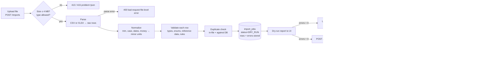
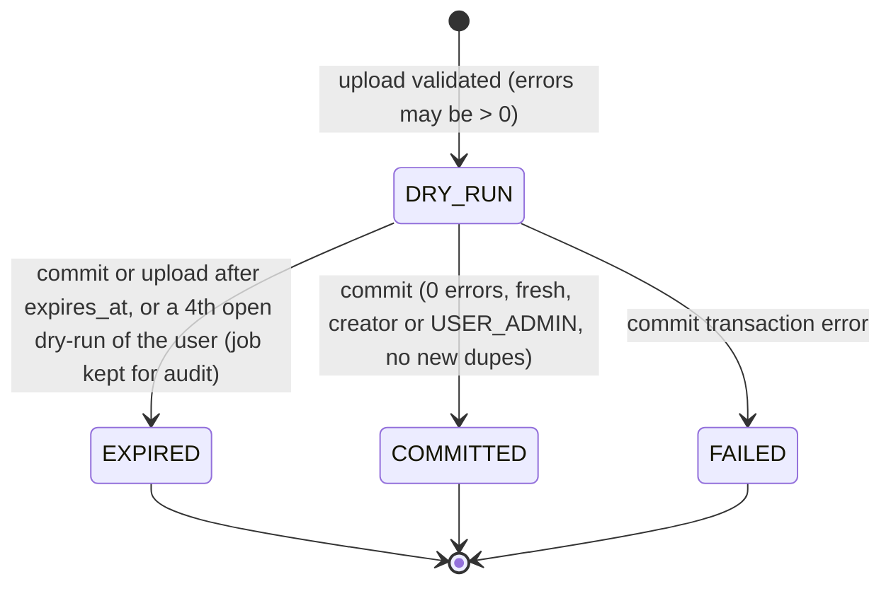

# 11 — Bulk Import & Export (CSV + XLSX)

> **Purpose:** Specify how HR moves employee and salary data in and out of the system with CSV and Excel files: the import template, validation pipeline, dry-run and all-or-nothing commit, safety rules, and role-aware export.

- **Status:** Draft for review
- **Last updated:** 2026-10-24
- **Related docs:** [01-prd.md](01-prd.md) · [06-data-model.md](06-data-model.md) · [07-api-spec.md](07-api-spec.md) · [08-security-rbac.md](08-security-rbac.md) · [13-frontend-ux.md](13-frontend-ux.md) · [14-testing-strategy.md](14-testing-strategy.md) · [17-deployment.md](17-deployment.md) · [19-performance.md](19-performance.md) · [adr/0012-bulk-import-dry-run.md](adr/0012-bulk-import-dry-run.md) · [adr/0011-audit-events.md](adr/0011-audit-events.md)

---

## 1. Why this exists

ACME's HR team **manages salaries in Excel today** (problem statement). Two consequences:

1. **Getting data in** must be painless and safe. A bad file must never half-load and corrupt records. Users must see *exactly* what is wrong, row by row, before anything is written.
2. **Getting data out** is still needed. HR will keep sharing spreadsheets with finance and leadership, so exports must respect permissions (no individual salaries for Viewers) and must not become an attack vector (CSV/Excel formula injection).

## 2. Scope

| In scope (v1) | Out of scope (v1) — reason |
|---|---|
| Import **new employees** with their current salary and components from **CSV or XLSX** | **Updating existing employees via file (upsert)**: more complex conflict semantics (which fields win, optimistic locking per row). Future work |
| Downloadable template (CSV and XLSX) | Importing salary *history* (multiple records per employee): the import creates the starting record only |
| Dry-run preview with per-row errors and duplicate detection | Partial commits ("import the valid rows only"): all-or-nothing is safer and simpler to reason about |
| All-or-nothing commit in one transaction | Background or async jobs: not needed at this size; serverless-friendly synchronous flow |
| Export of the filtered employee list as CSV or XLSX, role-aware | Scheduled or emailed exports |

> **Decided:** v1 import is **create-only**. A row whose `employee_code` or `email` already exists in the DB is reported as a duplicate error. Flagged in [03-clarifications.md](03-clarifications.md).

## 3. Permissions

| Action | Permission | Roles |
|---|---|---|
| Download template | `IMPORT` | HR_MANAGER, ADMIN |
| Upload → dry-run | `IMPORT` | HR_MANAGER, ADMIN |
| See or commit a dry-run | `IMPORT`, and be the job's creator or hold `USER_ADMIN` (the administrator's permission); anyone else gets `404` | HR_MANAGER, ADMIN |
| Export employees **with** salary columns | `EXPORT` + `SALARY_READ` | HR_MANAGER, ADMIN |
| Export employees **without** salary columns | `EXPORT` | VIEWER (salary columns stripped) |

See [08-security-rbac.md](08-security-rbac.md) for the full matrix.

---

## 4. Import template

One row per employee. Header names are **case-insensitive and trimmed**. Column order does not matter. Unknown columns produce an error, so typos like `emial` are caught.

| Column | Type / format | Required | Rules | Example |
|---|---|---|---|---|
| `employee_code` | string | ✅ | Pattern `ACME-` + six ASCII digits (as `POST /employees`); unique in file and DB | `ACME-010001` |
| `first_name` | string 1–100 | ✅ | Trimmed; Unicode allowed | `Jürgen` |
| `last_name` | string 1–100 | ✅ | Trimmed; Unicode allowed | `Müller` |
| `email` | email ≤ 254 | ✅ | Valid syntax; lowercased; unique in file and DB | `jurgen.muller@acme.example` |
| `job_role` | string | ✅ | Must match a title in the **controlled `job_roles` list** (case-insensitive exact match) | `Customer Success Manager` |
| `level` | enum | ✅ | `L1`–`L6` | `L2` |
| `employment_type` | enum | ✅ | `FULL_TIME`, `PART_TIME`, `CONTRACTOR` | `FULL_TIME` |
| `country` | ISO 3166-1 alpha-2 | ✅ | Must exist in `countries` | `DE` |
| `hire_date` | date `YYYY-MM-DD` (or an Excel date cell) | ✅ | Not in the future; not before 1970-01-01 | `2022-04-01` |
| `currency` | ISO 4217 | ⬜ | Defaults to the country's `default_currency`; if given, must equal it | `EUR` |
| `base_salary` | decimal, **major units**, annual | ✅ | > 0; at most as many decimals as the currency allows (JPY: 0, EUR: 2); no thousands separators | `52000.00` |
| `bonus_target` | decimal, major units, annual | ⬜ | ≥ 0; same precision rule. Stored as a `BONUS_TARGET` component named `Target bonus` | `4160.00` |
| `allowance_1_name` … `allowance_3_name` | string 1–60 (the API's component name rule) | ⬜ | Required if the matching amount is present; two allowances of one row can't share a name | `Transport` |
| `allowance_1_amount` … `allowance_3_amount` | decimal, major units, annual | ⬜ | > 0; precision rule | `1200.00` |
| `salary_effective_date` | date | ⬜ | Defaults to `hire_date`; not in the future; ≥ `hire_date` | `2022-04-01` |

Notes:
- **Up to 3 allowances per row (proposed).** That covers the seeded patterns (e.g. India: HRA + special allowance) without a nested format.
- Amounts are entered in **major units** because HR thinks in "52,000.00 EUR", not "5,200,000 cents". The parser converts to integer **minor units** using the currency exponent ([adr/0004-money-integer-minor-units.md](adr/0004-money-integer-minor-units.md)). An amount with more decimals than allowed (e.g. `1000.5` JPY) is an **error, never silently rounded**. Trailing zeros are fine (`1000.0` JPY is ¥1,000): only a non-zero digit past the currency's exponent is rejected.
- The imported salary record gets `reason = HIRE`, a `job_role_id` + `level` snapshot, and `changed_by` = the importing user ([06-data-model.md](06-data-model.md)).
- **Template download:** `GET /api/v1/imports/template?format=csv|xlsx` (`csv` by default), saved as `acme-import-template.csv|xlsx`. Both have the header row and one example row that imports as is (a seeded role and country, amounts in that country's currency). The CSV is UTF-8 with a BOM. The XLSX template's first sheet is `Employees` (dates as date cells, amounts as numbers), with dropdown data validation for `job_role`, `level`, `employment_type`, `country` and `currency` on rows 2–10,001, plus a second, protected sheet "Reference" listing the valid values (job roles with their department, levels with their names, employment types, active countries with name, and their currencies).

---

## 5. Pipeline



### 5.1 Parsing (format-specific, thin)

Parsing is the **only** format-specific step. Both parsers produce the same `RawRow = dict[str, str | None]` plus a row number. Everything after that is shared, so validation is written and tested once ([adr/0012-bulk-import-dry-run.md](adr/0012-bulk-import-dry-run.md)).

**CSV**
- Encoding: **UTF-8, with or without BOM**. Excel's "CSV UTF-8" export adds a BOM, and it is stripped. If decoding fails (e.g. Excel's legacy "CSV (Comma delimited)", which is Windows-1252), the upload is rejected with: *"File is not UTF-8. In Excel choose File → Save As → 'CSV UTF-8 (Comma delimited)'."*
- Delimiter: comma. Quoting: RFC 4180. Header row required. Blank lines are ignored.
- Parsed with Python's `csv` module (streamed, no pandas).

**File type.** The extension picks the parser: `.csv` or `.xlsx` (any case); anything else, including **`.xlsm`, `.xls` and `.xlsb`** (macros or legacy formats), is `415`. The declared MIME type is not trusted (Windows browsers send `application/vnd.ms-excel` for a CSV); instead the content must parse as the format the extension names, else `400` (a CSV renamed to `.xlsx` is `400 bad-request`).

**XLSX**
- `openpyxl.load_workbook(file, read_only=True, data_only=True)`:
  - `data_only=True` reads **cached cell values, never formulas**. A formula cell with no cached value refuses the upload (`400`): "Cell L2 has a formula without a saved value. Copy the cells and paste them as values, then upload again." Finding one needs a second, formulas-only read, done only when a worksheet's XML has a formula element.
  - Macros are never executed (openpyxl doesn't execute anything; macro-enabled formats are rejected anyway).
- **`defusedxml`** is installed so openpyxl parses XML safely (protects against XML entity expansion attacks).
- **Zip-bomb guard:** reject if the total uncompressed size of the archive exceeds 50 MB.
- Reads the **first sheet**, or the sheet named `Employees` if present, and only its first 50 columns (the template has 19), so a sheet that claims 16,384 columns costs nothing. A header row is required.
- Cell types: date cells → `YYYY-MM-DD` text; numeric cells → the decimal text of `Decimal(repr(value))` (`1234.56`, never `1234.5599…`); booleans → `TRUE`/`FALSE`; everything else → string. So both parsers hand the validator the same text.

**Both formats.** Header names are matched case-insensitively after trimming; unknown, repeated or missing required columns are one `400` that lists every problem and carries `expected_headers`. A value in a column with no header (often an unquoted comma in a CSV) is a `400` naming the row and column letter. Blank rows are skipped but still counted, so row numbers match the spreadsheet; more than 1,000 blank rows is refused as too many rows, so a file of empty lines or a sheet with one cell at row 1,048,576 is never walked row by row. A header row may have at most 50 columns (CSV and XLSX). A file with no employee rows is `400`; more than 10,000 rows is `422 validation` (`code: too_many_rows`).

### 5.2 Normalization

- Trim whitespace. Lowercase `email`. Uppercase `country`, `currency`, `level`, `employment_type`.
- Dates accept ISO `YYYY-MM-DD` or a native Excel date. Ambiguous formats (`03/04/2022`) are rejected with a hint.
- Money: strip a leading currency symbol? **No.** Symbols and thousands separators are rejected with a clear message, to avoid locale ambiguity (`1.234,56` vs `1,234.56`). After trimming, an amount must be a plain ASCII decimal (`52000.00`, `-12.5`, `+7`): `Money.from_major` rejects `_` grouping, inner spaces, exponents (`1e3`), `12.` / `.5` and non-ASCII digits. XLSX numeric cells are turned into a `Decimal` by the parser (above) before this check.

### 5.3 Row validation

Pydantic models validate each row against the **same domain rules** the create-employee API uses (one source of truth). Reference data (job roles, countries, currencies with FX rates) is loaded **once** per import, not per row.

### 5.4 Duplicate detection

| Check | Key | Error code |
|---|---|---|
| Within the file | `employee_code` | `duplicate_in_file` (reported on the 2nd and later occurrences, pointing to the first row) |
| Within the file | `email` | `duplicate_in_file` |
| Against the DB | `employee_code` exists | `duplicate_in_db` |
| Against the DB | `email` exists | `duplicate_in_db` |

DB checks run as **one batched query per key** (`WHERE employee_code IN (...)`), not one per row.

### 5.5 Dry-run report

Stored in `import_jobs` and returned to the UI with `201` (a report with row errors is still a `201`; `GET /imports/{id}` returns the same shape):

```json
{
  "id": 31,
  "status": "DRY_RUN",
  "format": "XLSX",
  "filename": "q4-new-hires.xlsx",
  "row_count": 248,
  "valid_count": 245,
  "error_count": 3,
  "errors": [
    { "row": 12, "column": "email",       "code": "duplicate_in_file", "message": "Same email as row 4.", "value": "a.rao@acme.example" },
    { "row": 31, "column": "job_role",    "code": "unknown_value",     "message": "'Sr Engineer' is not a known job role. Did you mean 'Software Engineer'? Job roles: Account Executive, …", "value": "Sr Engineer" },
    { "row": 77, "column": "base_salary", "code": "too_many_decimals", "message": "JPY amounts can't have decimals.", "value": "450000.5" }
  ],
  "preview": [
    { "row": 2, "employee_code": "ACME-010001", "first_name": "Ananya", "last_name": "Rao", "email": "ananya.rao@acme.example",
      "job_role": "Software Engineer", "department": "Engineering", "level": "L2", "employment_type": "FULL_TIME",
      "country_code": "IN", "hire_date": "2026-09-01", "salary_effective_date": "2026-09-01",
      "base":  { "amount_minor": 150000000, "currency": "INR" },
      "total": { "amount_minor": 162000000, "currency": "INR" } }
  ],
  "created_at": "2026-10-24T10:45:00Z",
  "expires_at": "2026-10-25T10:45:00Z",
  "committed_at": null
}
```

- `row` numbers are **spreadsheet row numbers** (header = row 1), so the user can find the row in Excel.
- `valid_count` counts rows without any error; `error_count` counts the entries of `errors` (one row can have several). Rows with errors = `row_count − valid_count`.
- Error codes: `required`, `invalid_format`, `unknown_value` (the message lists the allowed values), `too_many_decimals`, `duplicate_in_file`, `duplicate_in_db`, and, as `POST /employees` names the same rules, `future_date`, `before_hire_date` and `currency_mismatch` ([glossary](glossary.md) §6).
- Messages are written for HR users, with a "did you mean" suggestion for near-miss job roles (case-insensitive, then Python's `difflib` closest match).
- `preview` holds the first 50 valid rows, for a sanity check in the UI. There is no `summary` block: the UI can count the preview or the errors itself.
- Department isn't an import column. It is **derived from `job_role`** ([06-data-model.md](06-data-model.md)).
- An **error report download** (CSV of `row, column, code, message, value`) is offered in the UI and generated client-side from the JSON.
- A dry-run with errors stays inspectable, but **cannot be committed**. The user fixes the file and re-uploads, which creates a new job.
- A `DRY_RUN` job past `expires_at` is shown as `EXPIRED` by `GET`, which writes nothing; it is stored as `EXPIRED` at the next upload or commit attempt.

### 5.6 Commit (all or nothing)

`POST /api/v1/imports/{id}/commit`

Preconditions (otherwise `409 Conflict` problem+json):
- `status == DRY_RUN` and `error_count == 0`.
- `expires_at` not passed: **24 hours** after the dry-run. This bounds the gap between validation and commit. The DB duplicate re-check below covers changes made in the meantime.
- Requested by the job's creator or a caller holding `USER_ADMIN` (the administrator's permission; anyone else gets `404`, as if the job did not exist).
- **DB duplicates re-checked**, because someone else may have created one of these employees since the dry-run.

Execution:
- **One DB transaction**: insert employees → salary records → salary components → point each employee at its `HIRE` record → audit event → mark the job `COMMITTED`.
- Bulk inserts (SQLAlchemy `insert()` with lists of rows, in chunks of 1,000), the same approach as the seed ([12-seed-data.md](12-seed-data.md)). Employee and record ids are allocated in Python (one more than the highest in use; the transaction holds SQLite's write lock from `BEGIN IMMEDIATE`), so no `RETURNING` is needed. `employees` and `salary_records` reference each other, so employees go in with `current_salary_record_id` null and one bulk `UPDATE` sets it once the records exist (foreign keys are checked per statement; a deferred check would be SQLite-only).
- The `HIRE` record has `effective_date = salary_effective_date` (the hire date by default), `changed_by` = the importing user, the role and level as a snapshot, and the allowances and the bonus target as components. The employee's current salary columns and `search_text` follow the same rules as `POST /employees`.
- A duplicate found at commit returns `409` problem+json `duplicate` whose `conflicts` lists the rows (`{row, column, code: "duplicate_in_db", message, value}`); the job stays `DRY_RUN`. Any other exception rolls back, then, in a transaction of its own, marks the job `FAILED` with `failure_reason` (the error type, plus the database's message for a database error; never row values) and writes `import.fail`, and returns `500` problem+json `import-failed`. **No partial data is ever written.**
- Response: `{ id, status: "COMMITTED", inserted }`.

### 5.7 `import_jobs` lifecycle



Stored fields (see [06-data-model.md](06-data-model.md)): `id`, `filename`, `format`, `status`, `row_count`, `error_count`, `errors` (JSON), **`payload` (JSON of normalized valid rows)**, `created_by`, `created_at`, `expires_at`, `committed_at`, `failure_reason`.

Why the payload is stored in the DB: **Vercel functions are stateless**. The commit request may hit a different instance, so the validated payload must be persisted between the two requests ([17-deployment.md](17-deployment.md)).

Retention: `payload` and `preview` hold salary data, so they are cleared **as soon as the job ends** (`COMMITTED`, `FAILED` or `EXPIRED`), not after a retention period: v1 has no background jobs to clear them later. `payload` is only stored at all when the dry-run has no errors, since only then can it be committed. Every upload also marks all `DRY_RUN` jobs past `expires_at` as `EXPIRED` (one `UPDATE`), so an abandoned dry-run keeps its rows at most until the next upload after its 24 hours. Job metadata and errors are kept for audit.

### 5.8 Limits

| Limit | Value | Reason |
|---|---|---|
| Max upload size | **4 MB** | Vercel's 4.5 MB request body cap; a 10k-row CSV is ~1.5 MB |
| Max rows per file | **10,000** | Matches org size; keeps validation and commit within function time limits |
| XLSX uncompressed size | **50 MB** | Zip-bomb guard |
| Dry-run validity | **24 hours** | Bounds stale validation; duplicates are re-checked at commit anyway |
| Open dry-runs per user | **3** | Bounds stored salary data. A new upload never fails for this: it marks the user's oldest open dry-runs `EXPIRED` (rows cleared), so at most 3 stay open. A 409 instead would lock out a user who uploaded 3 files with errors, since a dry-run can't be deleted |

Performance targets for a 10k-row import (parse + validate + dry-run < 5 s; commit < 30 s against Turso, checked against the spike's bulk-insert timing) are tracked in [19-performance.md](19-performance.md). Ids are pre-allocated in Python, so no `RETURNING` is needed (§5.6).

---

## 6. Export

`GET /api/v1/employees/export?format=csv|xlsx&<same filters as the list endpoint>`

### 6.1 Behaviour

- Applies **exactly the same filters** as `GET /api/v1/employees` (search, country, department, job role, level, status, employment type, currency, salary range). "What you see is what you export."
- As on the list endpoint, **salary-range filters and sorting by salary need `SALARY_READ`**. A Viewer export that includes them is rejected with `403` (filtering by salary could reveal individual pay).
- Sort order matches the list's current sort (the same `sort` parameter).
- Rows: the whole filtered set, with no paging (`page` is refused) and no cap of its own; at ACME's size (≈ 10k) a CSV is ~1 MB and an XLSX ~600 KB, both within Vercel's 4.5 MB response cap.
- Filename: `acme-employees-YYYY-MM-DD.csv|xlsx`, via `Content-Disposition`.
- CSV is written as **UTF-8 with BOM**, so Excel shows `Müller` and `José` correctly when the file is double-clicked.

### 6.2 Columns by role

| Column | HR_MANAGER / ADMIN | VIEWER |
|---|---|---|
| employee_code, first_name, last_name, email | ✅ | ✅ |
| department, job_role, level, employment_type | ✅ | ✅ |
| country, status, hire_date | ✅ | ✅ |
| currency | ✅ | ❌ |
| base_salary (major units) | ✅ | ❌ |
| bonus_target, allowances_total | ✅ | ❌ |
| total_comp (major units) | ✅ | ❌ |
| base_salary_usd, total_comp_usd + `fx_as_of` | ✅ (blank for a currency without a USD rate: never a guessed rate) | ❌ |

- For Viewers, salary columns are **removed server-side**, not just hidden in the UI.
- Money is exported as major-unit decimal strings with the currency in its own column, e.g. `52000.00` + `EUR` (JPY: `4500000`).
- The export column order mirrors the import template where the two overlap, so an export can be edited and become a future upsert file: `employee_code, first_name, last_name, email, job_role, level, employment_type, country, hire_date, department, status`, then for `SALARY_READ` `currency, base_salary, bonus_target, allowances_total, total_comp, base_salary_usd, total_comp_usd, fx_as_of`. Amounts are the current salary, annual; `bonus_target` and `allowances_total` sum the current record's components of each type.

### 6.3 Formula-injection neutralisation (CSV and XLSX)

Spreadsheet apps execute cells that start with formula characters. A malicious name like `=HYPERLINK("http://evil","click")` could run when finance opens the export.

Rule (follows OWASP CSV Injection guidance): any **string** cell whose first character is `=`, `+`, `-`, `@`, tab (`\t`) or carriage return (`\r`) is prefixed with a single quote `'`.

- Applied to **all user-controlled text fields** (names, email, job role, allowance names) in both CSV and XLSX.
- Numeric columns are written as numbers (XLSX) or plain numeric strings (CSV), so negative numbers aren't affected. Salaries are positive anyway.
- XLSX: openpyxl writes text as a formula only when it starts with `=`, which the escaping never leaves, so every text cell is a string cell (`t="s"`); a test reads the cell types back. Amounts are number cells and dates date cells. (A `WriteOnlyCell` with an explicit type per text cell cost 1.3 s per 10,000 rows, for no extra safety.)
- One function, `modules/exports/csv_safety.py` `escape_formula`, does it for both formats and is unit-tested on its own.
- XLSX text also drops the control characters XML 1.0 cannot hold (such as `\x0b`), before the escaping; openpyxl refuses them, which would fail the whole export.
- Tested with a fixture employee named `=1+1` and `@SUM(A1)` in both formats ([14-testing-strategy.md](14-testing-strategy.md)).

### 6.4 Audit

Each export writes `export.download` to `audit_events` with: format, filters, row count, and `salary_included: true|false` ([adr/0011-audit-events.md](adr/0011-audit-events.md)).

---

## 7. Audit events (import and export)

| Action | When | `diff` payload |
|---|---|---|
| `import.dry_run` | Upload validated (row errors or not) | `{ job_id, filename, format, file_sha256, row_count, valid_count, error_count }` |
| `import.commit` | Commit succeeded | `{ job_id, inserted, employee_code_range: [lowest, highest] }` |
| `import.fail` | Commit rolled back (written after the rollback, with the `FAILED` status) | `{ job_id, failure_reason }` |
| `export.download` | Export downloaded | `{ format, filters, row_count, salary_included }` |

A committed import writes **one summary event** rather than 10k `employee.create` events. The job id links the summary to the job; the imported employees' `HIRE` records carry the importer as `changed_by`. The entity is `import_job` for the import events and `employee` (no id) for `export.download`.

---

## 8. Test plan (summary)

Detailed in [14-testing-strategy.md](14-testing-strategy.md):

- **Parsers:** CSV with and without BOM, Windows-1252 rejected, quoted commas, blank lines; XLSX date cells, numeric float artefacts, formula without cached value, `.xlsm` rejected, oversized archive rejected.
- **Parity:** the same dataset as CSV and as XLSX gives **identical** normalized rows and identical error lists.
- **Validation:** each rule with a failing row (unknown job role, bad level, too many decimals for JPY, future hire date, missing allowance name).
- **Duplicates:** in-file (code, email), against the DB, and a new duplicate created between dry-run and commit → 409.
- **Commit:** all rows created with salary records and components; an injected failure mid-transaction → nothing written, job `FAILED`.
- **Permissions:** VIEWER → 403 on import; another HR user can't commit someone else's job.
- **Export:** filters respected, Viewer columns stripped, formula-injection fixtures neutralised, BOM present, audit event written.

## 9. Open questions

- Create-only vs upsert in v1 → **create-only (decided)**. Upsert is future work: it needs per-field merge rules and per-row optimistic locking.
- 3 allowance column pairs per row → **(proposed)**. (Caps are settled: 4 MB, 10,000 rows, 50 MB uncompressed XLSX, 24 h dry-run expiry.)
- Include USD columns in the HR export → **(proposed: yes)**.
