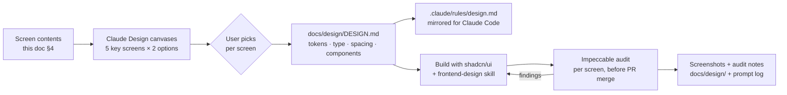

# 13 — Frontend & UX

> **Purpose:** Describe the web app from the user's side: information architecture, every screen and what it contains, role-aware behaviour, URL state, money formatting, the design workflow (Claude Design → DESIGN.md → Impeccable audit), visual direction, and accessibility.

- **Status:** Draft for review
- **Last updated:** 2026-10-24
- **Related docs:** [01-prd.md](01-prd.md) · [05-architecture.md](05-architecture.md) · [07-api-spec.md](07-api-spec.md) · [08-security-rbac.md](08-security-rbac.md) · [09-insights-pay-equity.md](09-insights-pay-equity.md) · [10-ai-ask-design.md](10-ai-ask-design.md) · [11-import-export.md](11-import-export.md) · [14-testing-strategy.md](14-testing-strategy.md) · [16-claude-code-setup.md](16-claude-code-setup.md) · [adr/0008-fastapi-auth-same-origin-rewrite.md](adr/0008-fastapi-auth-same-origin-rewrite.md) · [adr/0014-contract-first-openapi-client.md](adr/0014-contract-first-openapi-client.md) · [adr/0018-design-workflow.md](adr/0018-design-workflow.md)

---

## 1. Users and their jobs

| Persona | Role | Main jobs in the UI |
|---|---|---|
| **Hema**, HR Manager | `HR_MANAGER` | Find an employee fast; update details; record a raise or promotion; import new hires from Excel; answer leadership's pay questions; spot unfair pay |
| **Arun**, HR systems admin | `ADMIN` | Everything Hema does, plus manage users and roles, FX rates, countries, and review the audit log |
| **Farah**, Finance / leadership | `VIEWER` | See how the org pays (aggregates, distributions, pay equity), export headcount lists, ask questions. **Never sees individual salaries** |

Design consequence: this is a **data-dense internal tool used daily**. Speed, legibility of numbers, and trust ("is this figure in EUR or USD?") matter more than visual flair.

## 2. Information architecture

```
┌──────────────────────────────────────────────────────────────┐
│ ACME Pay   [Insights] [Employees] [Ask]          Hema Iyer ▾ │  ← top bar (Ask hidden if feature off or no ASK)
├──────────────────────────────────────────────────────────────┤
│ page content                                                 │
└──────────────────────────────────────────────────────────────┘
```

| Route | Screen | Visible to |
|---|---|---|
| `/login` | Sign in | everyone (unauthenticated) |
| `/` | → redirects to `/insights` | — |
| `/insights` | **Insights dashboard** (org overview) | all roles (`INSIGHTS_READ`) |
| `/insights/pay-equity` | **Pay equity** | all roles; drill-down to individuals needs `SALARY_READ` |
| `/employees` | **Employee directory** | all roles (`EMPLOYEE_READ`); salary columns need `SALARY_READ` |
| `/employees/new` | Create employee | `EMPLOYEE_WRITE` |
| `/employees/[id]` | **Employee detail** + salary timeline | all roles; salary sections need `SALARY_READ` |
| `/employees/import` | **Import** (upload → preview → commit) | `IMPORT` |
| `/ask` | **Ask about pay** | `ASK` and feature enabled |
| `/admin/users` | Users & roles (**cut from v1**) | `USER_ADMIN` |
| `/admin/fx-rates` | FX rates (**cut from v1**) | `FX_ADMIN` |
| `/admin/countries` | Countries (default currency) (**cut from v1**) | `REFERENCE_ADMIN` |
| `/admin/audit` | Audit log (**cut from v1**) | `AUDIT_READ` |

Navigation is a **top bar** from 640 px up and a **bottom bar** on phones (Insights, Employees, Ask; §8). The top bar always holds the **account menu**: the person's name, role and email, *Import employees* for `IMPORT` holders, and *Sign out*. The Admin menu is cut from v1. Insights is the landing page, because the problem statement centres on "answering questions about how the org pays people".

**Auth redirect:** `proxy.ts` (Next 16's middleware) redirects requests without a `session` cookie to `/login?next=…`. When the cookie is there but the session has expired, the shell's `GET /auth/me` answers 401 and `getMe()` sends the person to `/login?next=…` too, using the page that `proxy.ts` passes on in the `x-pathname` request header. Routes the user's permissions don't allow show a 403 page with a link home. The **backend is the enforcement point**; the UI only hides things ([08-security-rbac.md](08-security-rbac.md)).

## 3. Global UI patterns

### 3.1 Data loading and mutations

- **Server Components** fetch data on the server through a typed `openapi-fetch` client, forwarding the auth cookie. First paint arrives with data, with no client fetch waterfall ([adr/0008-fastapi-auth-same-origin-rewrite.md](adr/0008-fastapi-auth-same-origin-rewrite.md)).
- **Server Actions** handle mutations, followed by `revalidatePath`. Optimistic locking conflicts (`409`) show a dialog: "This employee was changed by someone else. Reload to see their changes."
- Toasts (sonner) confirm success; errors show the problem+json `detail` message in plain language.
- Loading: route-level `loading.tsx` skeletons that match the final layout (no layout shift).

### 3.2 URL as state (nuqs)

All filter, sort, and paging state lives in the **URL query string**, managed with `nuqs`:

```
/employees?q=müller&country=DE&department_id=1&level=L3&status=ACTIVE&sort=-current_base&page=2&page_size=25
/insights?country=DE&comp=total&period=monthly
/insights/pay-equity?country=DE&department_id=4
```

URL parameters use the API's names ([glossary](glossary.md) §6), so a page URL maps straight onto its API call. `period` is the one UI-only parameter. Benefits: links can be shared ("look at this view"), the back and forward buttons work, refresh keeps state, and the Ask feature's **"View in dashboard"** link is just a URL ([10-ai-ask-design.md](10-ai-ask-design.md)).

Paging defaults: **page size 25**, options 25 / 50 / 100 (max 100) ([07-api-spec.md](07-api-spec.md)).

### 3.3 Money formatting rules

| Rule | Detail |
|---|---|
| Source | The API returns `{ amount_minor, currency }`. The UI never receives floats |
| Formatter | One utility in `lib/money.ts`, `formatMoney(amountMinor, currency, { period, compact, minorUnits, locale })`, that uses `Intl.NumberFormat` with `style: "currency"` and the **currency's minor-unit exponent** (JPY 0, others 2, read from `Intl`). Minor units that are all zero are left out, as in the design (`€54,000`, but `€4,500.50`); `minorUnits: "always"` keeps them for columns that must line up. It refuses a `number` that is not a safe integer |
| No float maths | Conversion to a display number uses `BigInt`/string arithmetic for the major/minor split. Monthly display is (annual ÷ 12), rounded half-even at the minor unit, **display only** |
| Currency always visible | Every amount shows its currency (code or symbol + code where ambiguous, e.g. `$` for USD vs CAD vs AUD → `US$`, `CA$`, `A$`) |
| USD conversions | Shown as a secondary value, e.g. `€52,000 · ≈ US$56,160`, with a tooltip: "FX as of 2026-10-01 (illustrative)" |
| Locale | A **fixed** locale, so server-rendered and hydrated text are identical: `en-US` grouping by default, and Indian lakh grouping (`₹22,20,000`) for INR via `en-IN`. The `locale` option overrides it. Ratios, percentages and counts use `formatRatio`, `formatPercent` and `formatCount` in `lib/numbers.ts` (decimal strings in, half-even) |
| Tabular figures | All numeric table cells use `font-variant-numeric: tabular-nums` and right alignment, so digits line up |
| Compact mode | Charts and summary sentences may use compact notation (`€1.2M`, `formatMoney(..., { compact: true })`); tables always show full values |

Unit tests cover JPY (no decimals), INR grouping, negative amounts (a salary decrease), refused inputs (fractions, unsafe numbers, strings that aren't plain digits), BigInt-sized amounts, and monthly rounding ([14-testing-strategy.md](14-testing-strategy.md)).

### 3.4 Global toggles: comp basis and period

Shown on all insight screens and on the employee list (salary columns):

- **Base | Total comp**: maps to the `comp=base|total` API parameter ([09-insights-pay-equity.md](09-insights-pay-equity.md) §2.2). The tooltip explains: "Total = base + allowances + target bonus. Equity and commission are not included."
- **Annual | Monthly**: client-side display only (`period` URL param).
- **Population chip**: "Full-time · Active". Click to change employment type or status. Makes the default visible ([09-insights-pay-equity.md](09-insights-pay-equity.md) §2.1).

### 3.5 Role-aware UI

| Element | HR_MANAGER / ADMIN | VIEWER |
|---|---|---|
| Salary columns in the employee list | Shown | Hidden (column absent; the API returns salary fields as `null` with `"salary_masked": true`) |
| Salary-range filter, sort by salary | Shown | Hidden (API returns `403`) |
| Employee detail: compensation + timeline | Shown | Replaced by a neutral note: "Compensation details are restricted for your role" |
| Create / edit / terminate / record change buttons | Shown | Hidden |
| Import | Shown | Hidden |
| Export | With salaries | Without salaries; the button label says "Export (no salary data)" |
| Small groups in insights | Values shown | Values **and headcount** shown as "—" with tooltip "Hidden to protect individual pay (fewer than 5 people)" |
| Pay-equity drill-down to names | Shown | Hidden; cohort counts only |
| Admin menu | ADMIN only | Hidden |

The permission set comes from `GET /api/v1/auth/me` (`permissions[]`, `features{}`). Components check **permissions**, not role names ([adr/0009-permission-rbac-small-group-rule.md](adr/0009-permission-rbac-small-group-rule.md)).

### 3.6 Empty, loading and error states

Every screen defines:

- **Empty:** a friendly explanation plus the next action, e.g. "No employees match these filters" with a "Clear filters" button.
- **Loading:** a skeleton matching the layout.
- **Error:** problem+json `title`/`detail`, a "Try again" button, and a request ID for support (from the `X-Request-ID` header).
- **Forbidden:** "You don't have access to this" (never a blank page).

---

## 4. Screens

### 4.1 Login (`/login`)

- Email and password fields, a "Sign in" button, and the error "Email or password is incorrect" (no hint about which one).
- After login, redirect to `next` or `/insights`.
- The demo environment shows a small banner with the three demo accounts (Arun, Admin; Hema, HR Manager; Farah, Viewer) with their emails, **demo deployment only** (`NEXT_PUBLIC_SHOW_DEMO_ACCOUNTS=true`), so reviewers can try each role ([12-seed-data.md](12-seed-data.md) §11). It never shows passwords; they are in the README.
- 429 (5 failures in 15 minutes) says "Too many attempts. Try again in N minutes." from `Retry-After`; any other failure says "Couldn't sign you in. Try again in a moment."
- `next` must be a path on this site (`/…`, not `//…`), otherwise `/insights`. The form posts with a client `fetch`, then does a full page load to `next`.

### 4.2 Insights dashboard (`/insights`)

**Question it answers:** "How does the org pay people, at a glance?"

| Area | Content |
|---|---|
| Header | Title, global toggles (Base/Total, Annual/Monthly), population chip, filters: country, department, job role, level |
| Summary sentence | Headcount · Total annual payroll (USD) · Median pay (USD, org-wide) · Countries · FX as-of date, written as one sentence under the title, not KPI tiles ([design/DESIGN.md](design/DESIGN.md)) |
| **Pay by country** table | Country, headcount, min, P25, **median**, mean, P75, max in **local currency**, plus a USD median column; sortable; a row click filters the dashboard to that country |
| **Salary distribution** chart (**cut from v1**) | Histogram (local currency when one country is selected, otherwise USD, with a visible label); P25, median, and P75 reference lines |
| **Pay by department** | Bar chart of median (and mean on hover). Currency label follows the single- or mixed-currency rule |
| **Department cost** | Horizontal bar of total payroll in USD with share-of-total % |
| **Raises** (**cut from v1**) | Date-range picker (default: last 12 months); average raise % by department; stacked count by reason (Merit / Promotion / Market adjustment / Correction) |
| **Top / bottom earners** (HR/Admin) | Country selector (required), top 10 / bottom 10 table with links to employees |
| Links | "Open pay equity →" · "Ask a question →" |

Rules: when a group mixes currencies, the section header shows a **"USD"** badge with the FX tooltip. Local-currency sections show the currency code in the header.

### 4.3 Pay equity (`/insights/pay-equity`)

**Question it answers:** "Are we paying people fairly against the pay band for their job, and is any team systematically below band?"

| Area | Content |
|---|---|
| Explainer (collapsible) | "Compa-ratio = base pay ÷ the midpoint of the pay band for the same role, level and country. Below 0.8 is under the band minimum (may be underpaid); above 1.2 is over the band maximum." |
| Filters | Country (recommended), department, job role, level. The Base/Total toggle is disabled here (tooltip: "Pay bands are defined on base salary") |
| Summary tiles | Employees evaluated · Employees below band · Employees above band · Departments below threshold |
| **Cohort table** | Role · Level · Country · Headcount · P25 · Median · P75 · Band min/mid/max (local currency) · Median compa-ratio · # underpaid · # overpaid. Sort by most flagged. A spread bar shows P25–P75 and the median tick drawn over the band (min–max shaded, mid marked) |
| **Department rollup** (shown first) | Bar chart + table: median compa-ratio per department in the selected country, with a reference line at 1.00 and a threshold line at 0.95. Departments below 0.95 get a "Systematically below band" badge ([09-insights-pay-equity.md](09-insights-pay-equity.md) §3.8) |
| **Drill-down** (HR/Admin) | Click a cohort → flagged employees: name, code, pay, band, compa-ratio badge (red < 0.8, amber > 1.2), link to the employee |
| Viewer | Department rollup + cohort table (no drill-down); groups with < 5 people suppressed; band values visible |

### 4.4 Employee directory (`/employees`)

**Question it answers:** "Find someone / a set of people, fast."

| Area | Content |
|---|---|
| Toolbar | Search box (name, employee code, email; debounced 300 ms; searches from 2 characters, the API's minimum; **case- and accent-insensitive**: `muller` finds `Müller` and `jose` finds `José`, via the backend's lowercased, accent-stripped `search_text`); filters: country, department, job role, level, employment type, status, currency (popover buttons on a desktop, a "Filters (n)" sheet with removable chips on a phone); "Sort by" (name, employee code, hire date, country, level and, with `SALARY_READ`, base or total pay). **Pay range and pay sorts** (`SALARY_READ` only) are enabled only when the API can compare pay: one country, one currency, or "Compare pay in: US dollars" (`salary_basis=usd`); otherwise they are disabled with a short hint and never sent. **For Viewers, the pay range, pay sorts and pay toggles are not shown** (the API rejects them with `403`) |
| Actions | **Add employee** (`EMPLOYEE_WRITE` + `SALARY_WRITE`) · **Import from Excel** (`IMPORT`) · **Export** (`EXPORT`): a menu with CSV and Excel (.xlsx), labelled "Export (no salary data)" without `SALARY_READ`; it downloads `GET /employees/export` with the list's query minus `page`/`page_size`, and shows the API's problem in a toast on a non-2xx |
| Table (server-side paging and sort; a plain table, nothing is sorted or paged in the browser) | Name (employee code below) · Job role and level · Department (from 768 px) · Country · Type (from 1024 px) · **one pay column** (`SALARY_READ` only): base or total, a year or a month, following the Base/Total and Annual/Monthly toggles · Hired (from 1024 px). Below 640 px the rows become a card list |
| Row | Click the name → detail. Terminated rows are greyed and say "Terminated" in words |
| Footer | "Showing 26–50 of 9,700" · rows per page 25/50/100 (desktop only) · Previous / Next |
| Empty | "No employees match these filters" + Clear filters; a page past the end offers "Go to the first page" |

Export uses the **current URL filters**: what you see is what you export ([11-import-export.md](11-import-export.md) §6).

### 4.5 Employee detail (`/employees/[id]`)

| Section | Content | Permission |
|---|---|---|
| Header | Name; one sentence with job role, level, department, country, type, hire date and code; "Terminated on …" in words; actions: **Edit details**, **Terminate / Reactivate** (confirmation dialog), **Record salary change** (hidden for a terminated employee: reactivate first). On a phone, Record salary change sits in a bar fixed above the bottom navigation | actions need `EMPLOYEE_WRITE` / `SALARY_WRITE` |
| **What is … paid?** | **Total pay** highlighted, then base and each allowance or bonus target; Annual/Monthly toggle (`period`, display only); the reason and date of the current record. Viewers see "Compensation details are restricted for your role." instead | `SALARY_READ` |
| **How did …'s pay get here?** | Every record, newest first: date, reason in words (Hired / Promotion / Merit raise / Market adjustment / Correction), role or level change ("L2 to L3"), changed by, old → new base, **% change** (`base_change_pct` from the API) and the note. Not fetched at all without `SALARY_READ` | `SALARY_READ` |
| **Who is …?** | Email, code, job role, level, department, country, employment type, status, hire and termination dates | all |
| Not in v1 | A USD equivalent, the compa-ratio against the pay band and a line chart of base over time: `GET /employees/{id}` does not return a USD figure or the band, and the UI never converts or compares money itself | |
| Activity (proposed) | Recent audit events for this employee | `AUDIT_READ` |

**Record salary change** (a dialog; full screen on a phone with a sticky title and buttons):
- Fields: effective date (default today in UTC, the API's "today"; the date picker stops at today), reason (no "Hired"), optional new job role, level and country (a move shows the new currency and empties the amounts typed in the old one; the currency is sent so the API confirms it), new base and the components (pre-filled from the current record; add, change or remove rows; the list replaces the current one), note.
- Amounts are typed in **major units** (`inputmode="decimal"`, commas allowed) and turned into minor units with string maths, using the currency's exponent from `GET /reference`. More decimals than the currency has are refused with the API's message ("12.345 has more decimals than EUR allows").
- **The API checks every rule** (no future dates, not before the latest record, a promotion must change the level or the role, the currency follows the country); its `errors[]` show next to their fields. The form itself only asks for missing values and reads amounts. There is no live "+8.5%" preview: the change in percent and the totals come from the API, which the UI shows after saving.
- A `409 version-conflict` shows "This employee was changed by someone else. Reload to see their changes." with a Reload button.

**Edit employee**: profile fields only (name, email, employment type). **Salary, job role, level and country can't be edited here.** They change only through "Record salary change", so every change is captured in history with a reason. Department is derived from the job role and is not edited separately. The optimistic-lock `version` is sent in the request body.

### 4.6 Create employee (`/employees/new`)

Needs `EMPLOYEE_WRITE` **and** `SALARY_WRITE` (like `POST /employees`), otherwise "You don't have access to this". Three questions: "Who are they?" (names, email, optional employee code), "What is their job?" (job role, level, employment type, country, hire date) and "What will they be paid?" (the currency is shown from the country and can't be chosen, base in major units, components, note). Creates the employee and the HIRE salary record in one request. On success, opens the detail page with a "… was added." toast.

### 4.7 Import (`/employees/import`)

A three-step flow ([11-import-export.md](11-import-export.md)), shown as "1. Upload · 2. Check · 3. Import" above the title. Everything after the server's `IMPORT` check runs in the browser: the upload and the commit are client `fetch` calls through the `/api` rewrite. The dry-run's id stays in the URL (`?job=31`), so a refresh or a shared link reopens it with `GET /imports/{id}`.

1. **Upload** ("What should the file look like?" · "Which file do you want to check?"): CSV and Excel template links; short instructions ("CSV UTF-8 (Comma delimited)", 4 MB, 10,000 rows); a file picker that is also a drop zone on a desktop. Choosing a file checks it at once. Refusals are said in plain words: a header mismatch lists the `expected_headers`; an unreadable file repeats the API's detail; 413, 415 and `too_many_rows` say what to do.
2. **Check (dry-run)**:
   - Title and summary sentence: "3 rows need fixing" / "Ready to import 3 employees"; "q4-new-hires.csv has 248 rows. **245 are ready to import.**" Counts come from the API (`row_count`, `valid_count`, `error_count`). Counts by country and total base by currency are **not** shown: the API doesn't return them and the UI does no money arithmetic.
   - **What needs fixing?**: the problems grouped by spreadsheet row, the refused value ringed in red pen and the API's message (with its "did you mean") as an italic margin note; a table from 640 px, one card per row below it. **Download the list of problems** saves a CSV made in the browser from the JSON. When the API sends only the first 500 (`errors_truncated`), the section says "Showing the first 500 of 1,234 errors." (Filtering by error type is not built.)
   - **What can these columns hold?** (only when a cell had an unknown value): each such column with the values it accepts, from `allowed_values`.
   - **Who will be added?**: the preview rows (the API's first 50), base and total pay a year, formatted with `lib/money.ts`.
   - Footer: "Import 245 employees" (disabled while `error_count > 0`), "Upload the fixed file", and "This check is kept until 25 Oct 2026, 10:45 UTC."
   - A refused commit is shown above the footer: `409 duplicate` lists the `conflicts` rows the same way; `409 invalid-state` and `500 import-failed` repeat the API's detail (with the request ID). Each disables Import and offers "Upload the file again".
3. **Import**: an "Imported 248 employees" toast, "248 employees imported" and a link to the employee list (a list filtered to the new codes stays **proposed**: the list API has no code filter). A `?job=` of a check that has ended says so: "This file was imported" (with the time), "This check has expired" or "This import failed" (nothing saved).

### 4.8 Ask about pay (`/ask`)

([10-ai-ask-design.md](10-ai-ask-design.md))

| Area | Content |
|---|---|
| Intro | "Ask about how ACME pays people. Answers use live data and show their sources." |
| Suggested questions (chips) | "Which country pays L3 engineers the most (USD)?" · "Are any teams paid below their band?" · "Average raise in 2025 by department?" · "Median total comp in Singapore?" |
| Conversation | Chat-style list. User bubble; **answer card** with markdown answer, **key figures** (amount + currency), caveats (e.g. "Full-time only · FX as of 2026-10-01"), **"How I got this"** (collapsible: tool names + arguments), **"View in dashboard"** link |
| Input | Text box (max 1,000 chars, same cap as the API) + Send; Enter sends, Shift+Enter adds a new line |
| Waiting | **Spinner** with "Thinking…" (no streaming in v1) |
| History | Kept in page state only; last 6 turns sent; "New conversation" clears it; a note says history is not saved |
| Errors | `429 rate-limited` → "The assistant is busy, try again in N s" (N from `Retry-After`; the problem `detail` says whether it's the hourly limit); `502 upstream-unavailable` → "The assistant is unavailable right now"; `503 feature-disabled` → the page isn't linked at all (`features.ask = false` from `/auth/me`) |
| Viewer | Same UI; access-limited answers are explained by the assistant |

### 4.9 Admin

> **Cut from v1** ([v1 scope](README.md#v1-scope-decided-2026-10-24-read-this-first)): no admin screens. Users, FX rates and countries are seeded. Kept here as the future-work design.

| Screen | Content |
|---|---|
| **Users** (`/admin/users`) | Table: name, email, role, active, last login (proposed). Actions: invite/create user (set a temporary password **(proposed)**), change role, deactivate. You can't deactivate or demote yourself (guard) |
| **FX rates** (`/admin/fx-rates`) | Table: currency, rate to USD, as-of, source. Edit a rate (decimal string input with validation), with a warning: "Changes affect all USD figures immediately; history is unaffected" |
| **Countries** (`/admin/countries`) | Code, name, default currency; edit the default currency (validated: must have an FX rate) |
| **Audit log** (`/admin/audit`) | Filterable table: time, actor, action, entity, summary; expandable diff JSON viewer; filters by actor, action, date range; URL-state |

---

## 5. Design workflow

> **v1:** no multi-step design phase. One time-boxed Claude Design canvas produced the chosen direction, "Marked-up printout": 6 desktop and 3 phone screens ([design/claude](design/claude/README.md)), with the rules in [design/DESIGN.md](design/DESIGN.md). The build uses shadcn/ui restyled to those rules; this doc wins on behaviour. Google Stitch was also tried (two directions) and dropped. The workflow below is the original, fuller plan.

([adr/0018-design-workflow.md](adr/0018-design-workflow.md), [16-claude-code-setup.md](16-claude-code-setup.md))



1. **Milestone 7b (design phase):** Claude Design / `/design` canvases for the **5 key screens**: Insights dashboard, Employee directory, Employee detail + salary timeline, Import review, Ask. Two options each; the user picks (or mixes).
2. **Freeze** the outcome as `docs/design/DESIGN.md`: colour tokens (light and dark), typography scale, spacing scale, radius, elevation, data-table rules, chart palette, iconography, component inventory (which shadcn components, which variants), and do/don't examples. Screenshots of the chosen canvases go in `docs/design/`.
3. **Mirror** the rules into `.claude/rules/design.md` (path-scoped to `frontend/**`) so Claude Code follows them while building.
4. **Build** with shadcn/ui + Tailwind v4 tokens from DESIGN.md, with the official **frontend-design** skill as guidance.
5. **Audit** each screen with **Impeccable** (anti-AI-slop rules; files reviewed before install) before its frontend PR merges. Findings and fixes are logged in [ai/prompt-log.md](ai/prompt-log.md). This is intentional evidence of catching and correcting AI output.

Google Stitch was considered and rejected: it adds a vendor, and its HTML output doesn't map to shadcn ([20-trade-offs.md](20-trade-offs.md)).

## 6. Visual direction (input to the design phase)

> **Superseded for look and feel by [design/DESIGN.md](design/DESIGN.md)** ("Marked-up printout"), which wins where this table differs: its own palette (no amber or green), serif titles, and **one light theme** (it defines no dark palette).

| Principle | Concretely |
|---|---|
| Calm, trustworthy, data-first | Neutral greys/slate base, **one accent colour**, semantic colours only for meaning (red = underpaid flag, amber = overpaid flag, green = success) |
| Numbers are the hero | Tabular numerals, right-aligned, a consistent decimals rule per currency, currency label always present |
| Dense but breathable tables | 40–44 px rows **(proposed)**, sticky header, zebra or hover highlight, truncation with tooltip |
| Typography | One clean sans family with true tabular figures; size scale ~12/14/16/20/24/32 **(proposed)** |
| Charts | Minimal gridlines, direct labels where possible, colour-blind-safe palette, every chart titled with its currency and population |
| Avoid "AI slop" | No purple gradients, no glassmorphism, no emoji headings, no cards inside cards, no generic hero sections. Impeccable enforces this |
| Themes | One light theme meeting contrast requirements (DESIGN.md defines no dark palette) |

## 7. Accessibility (target: WCAG 2.2 AA)

- Colour contrast ≥ 4.5:1 for text and ≥ 3:1 for UI components and chart elements. Flags never rely on colour alone (an icon plus the text "Underpaid").
- Full **keyboard** operation: visible focus rings, logical tab order, `Esc` closes dialogs, focus trapped in modals and returned afterwards (Radix primitives via shadcn).
- Tables use proper `<th scope>`, sortable headers announce their sort state (`aria-sort`), and pagination has labelled buttons.
- Charts have an accessible text alternative: a "View as table" toggle under each chart **(proposed)**.
- Forms: labelled inputs, error messages linked via `aria-describedby`, errors announced on submit.
- Live regions announce toasts and "Thinking…" or answer-ready status on the Ask page.
- `eslint-plugin-jsx-a11y` in CI; **(proposed)** axe checks in Playwright smoke tests ([14-testing-strategy.md](14-testing-strategy.md)).
- Respects `prefers-reduced-motion`. There is one light theme ([design/DESIGN.md](design/DESIGN.md)), so `prefers-color-scheme` is not used.

## 8. Responsive behaviour (fully mobile responsive)

**Every screen is fully usable on a phone**, not just "readable": every action available on desktop (search, filters, record a salary change, import, export, Ask, pay equity drill-down) works from 360 px wide upwards. Designs are made mobile-first and checked at **390 × 844** (phone), **768 × 1024** (tablet) and **1440 × 900** (desktop).

| Breakpoint (Tailwind) | Layout |
|---|---|
| < 640 px (`base`, phone) | Single column. The top bar keeps the name and the account menu; the main links (Insights, Employees, Ask) move to a **bottom navigation bar** fixed to the screen, clear of the safe-area inset ([design/DESIGN.md](design/DESIGN.md) "Mobile"). Summaries are sentences, not KPI tiles. Charts stack full width, using horizontal bars so labels stay readable |
| 640–1023 px (`sm`/`md`, tablet) | Two-column dashboard grid. Tables hide low-priority columns (hire date, type) behind a column picker |
| ≥ 1024 px (`lg`+, desktop) | Full dashboard grid; tables show all columns; side sheets open at the right |

Component rules on phones:

| Element | Phone behaviour |
|---|---|
| Data tables (employees, cohorts, top earners, import errors) | Become a **card list**: one card per row with the key fields (name, code, role · level, country, salary for HR) and a tap target to open the detail. No horizontal scrolling of the page |
| Filters | A "Filters (n)" button opens a bottom sheet with every filter; active filters show as removable chips under the search box |
| Toggles (Base/Total, Annual/Monthly) and population chip | Stay visible above the content as a compact segmented control |
| Side sheets and dialogs (record salary change, cohort drill-down, confirmations) | Open full screen with a sticky header (title + close) and a sticky footer (primary action) |
| Pay-equity range bars | Kept, scaled to the card width; numbers shown below the bar instead of beside it |
| Import | Upload by file picker (drag-and-drop is a desktop bonus); errors as cards grouped by row |
| Ask | Full-height chat; the input sticks to the bottom and stays above the on-screen keyboard |
| Pagination | "Previous / Next" with "26–50 of 9,700"; page-size picker hidden |

Rules that apply everywhere:
- Touch targets at least **44 × 44 px**; no hover-only information (tooltips also open on tap).
- No horizontal page scroll at any width ≥ 360 px; long names truncate with the full value on tap.
- Money stays on one line and never wraps between the symbol and the number; compact notation (`€1.2M`) is allowed in summary sentences and charts on phones.
- Text inputs use the right mobile keyboard (`inputmode="decimal"` for amounts, `type="email"` for email, `type="search"` for search).
- Respects safe-area insets (`env(safe-area-inset-*)`) for the sticky header and footers.

## 9. Performance (UX budgets)

- API p95 < 300 ms for list and insight endpoints ([19-performance.md](19-performance.md)). UI target: interactive dashboard < 2.5 s LCP on a warm function.
- Search is debounced (300 ms). Filter changes use `startTransition` so the UI stays responsive.
- Charts are lazy-loaded below the fold.

## 10. Frontend testing hooks

([14-testing-strategy.md](14-testing-strategy.md))

- Vitest + RTL: `formatMoney`, URL-state parsing, role-gated rendering (VIEWER sees no salary column), forms (record-change validation), import review states.
- MSW mocks the typed API for component tests.
- Playwright smoke: login as Hema → search → record raise → see the insight change; login as Farah → no salary visible.

## 11. Open questions

- Top bar vs sidebar navigation: **decided**: a top bar, and a bottom bar on phones (§2, §8).
- INR lakh grouping via the `en-IN` locale: **decided**, built into `formatMoney` (§3.3).
- "Link to newly imported employees" after an import: **(proposed)**.
- Role and level required on Promotion: **(proposed)**.
- Axe checks in Playwright: **(proposed)**.
