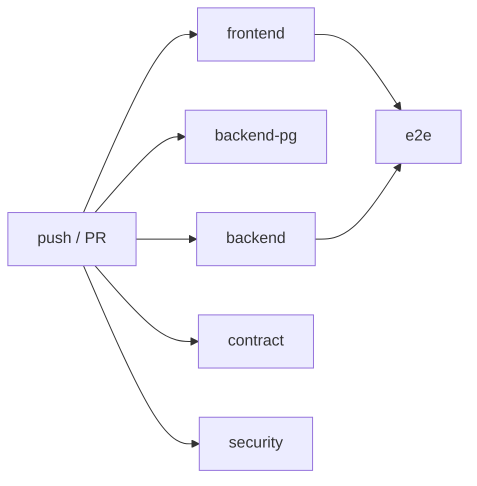

# 15 — Tooling & Developer Experience

Every tool in the repository, what it does and why we chose it, plus the Makefile, git hooks, CI pipeline and GitHub workflow.

- **Status:** Draft for review
- **Last updated:** 2026-10-24
- **Related docs:** [04-research.md](04-research.md) · [05-architecture.md](05-architecture.md) · [14-testing-strategy.md](14-testing-strategy.md) · [16-claude-code-setup.md](16-claude-code-setup.md) · [17-deployment.md](17-deployment.md) · [18-implementation-plan.md](18-implementation-plan.md) · [20-trade-offs.md](20-trade-offs.md) · [adr/0001-monorepo.md](adr/0001-monorepo.md) · [adr/0014-contract-first-openapi-client.md](adr/0014-contract-first-openapi-client.md) · [adr/0017-toolchain.md](adr/0017-toolchain.md)

---

## 1. Principles

1. **One command to start.** A reviewer clones the repo, runs `make setup && make dev`, and has a working app on local SQLite, with no Docker or cloud accounts.
2. **Same checks everywhere.** The commands run by git hooks, by `make verify` and by CI are the same commands. A green `make verify` locally predicts green CI.
3. **Fast tools.** Rust- and Go-based tools (uv, ruff, lefthook) keep the feedback loop short, which matters for TDD.
4. **Locked and reproducible.** Every dependency is pinned by a lockfile (`uv.lock`, `pnpm-lock.yaml`) and every runtime by a version file (`.python-version`, `.nvmrc`, `packageManager`).
5. **Boring where it counts.** Mainstream, well-documented tools over novel ones, unless the newer tool is clearly mature (researched Oct 2026, see [04-research.md](04-research.md)).

## 2. Version resolution policy

- Versions are **not** hard-coded in these docs. At scaffold time (milestone 1) we install the **latest stable** releases (`uv add <pkg>`, `pnpm add <pkg>`, `pnpm create next-app@latest`) and the lockfiles pin them.
- Pre-releases are excluded. Example: **SQLAlchemy 2.1** was at rc2 in September 2026; 2.1 final was out at scaffold time, so it is used.
- Runtimes: **Python 3.13**, **Node 22 LTS**. Recorded in `.python-version` and `.nvmrc`. Both are versions Vercel supports and the ones in the build environment.
- Updates after scaffold come only through Dependabot PRs (section 11), grouped monthly, so the history isn't polluted with dependency churn.
- The exact resolved versions are recorded in [adr/0017-toolchain.md](adr/0017-toolchain.md) (backend: done at scaffold).

---

## 3. Backend tools (Python)

| Tool | What it is | Why we use it |
|---|---|---|
| **Python 3.13** | The language runtime | A current version that Vercel's Python runtime supports. SQLAlchemy 2.1 needs ≥ 3.11, and 3.10 reaches end of life in Oct 2026 |
| **uv** | Package manager, virtualenv manager, lockfile tool and command runner (`uv sync`, `uv add`, `uv run`) | Replaces pip + venv + pip-tools + pyenv with one very fast tool. `uv sync --locked` in CI guarantees the exact locked dependency set. Dependency groups: `dev` (tools and tests) and `seed` (Faker); `uv sync` installs both |
| **FastAPI** | Web framework that turns typed Python functions into HTTP endpoints and generates an OpenAPI spec | The required stack. The OpenAPI output drives our typed frontend client ([adr/0014-contract-first-openapi-client.md](adr/0014-contract-first-openapi-client.md)) |
| **Pydantic v2** | Data validation and serialization | Validates every request body and query (`extra="forbid"`), and defines response schemas |
| **pydantic-settings** | Typed configuration from environment variables | The app refuses to start with missing or invalid config; prod refuses default secrets |
| **SQLAlchemy 2.x** | ORM / SQL toolkit | Typed `Mapped[...]` models. Switching between SQLite, Turso and Postgres is only a `DATABASE_URL` change ([adr/0002-sqlite-everywhere-turso.md](adr/0002-sqlite-everywhere-turso.md)) |
| **Alembic** | Schema migrations | Versioned, reviewable schema changes: git history for the database |
| **sqlalchemy-libsql** (Turso dialect) | Driver for the hosted SQLite (Turso) in prod: `sqlite+libsql://<db>.turso.io?secure=true` | Same SQLite dialect locally and in prod. Installed; a real Turso round trip is checked at deploy time ([17-deployment.md](17-deployment.md)) |
| **psycopg 3** (test group) | Postgres driver | Only for the portability CI job |
| **pwdlib[argon2]** | Password hashing with Argon2 | The current recommendation in the FastAPI docs, which dropped passlib |
| **PyJWT** | JWT encode and verify | The current recommendation in the FastAPI docs, which dropped python-jose |
| **openai SDK** | HTTP client for OpenAI-compatible LLM APIs | Gemini and Groq both expose OpenAI-compatible endpoints, so one adapter covers both ([adr/0015-ai-ask-tool-calling.md](adr/0015-ai-ask-tool-calling.md)) |
| **openpyxl** | Read and write `.xlsx` | Excel import and export. Read with `data_only=True` (values only, no formulas or macros) |
| **python-multipart** | Multipart form parsing | Required by FastAPI for file uploads |
| **Faker** (seed group) | Realistic fake names and emails per locale | Seed data only; never imported by app code |
| **structlog** | Structured (JSON) logging | Every log line is machine-searchable and carries a `request_id` from middleware |
| **ruff** | Linter + formatter | Replaces flake8, black, isort and bandit in one very fast tool. Rule set: `E,F,I,B,UP,SIM,S,PT,RUF,N,PL` |
| **Pyright** (strict on `src/`) | Static type checker | Highest typing-spec conformance (~98%), and the same engine as VS Code's Pylance, so the editor and CI agree. Rejected: mypy (slower, ~58% conformance), ty (still beta 0.0.x), Pyrefly (1.0 only since May 2026) |
| **pytest** | Test runner | Standard; fixtures and parametrization power the authz matrix |
| **pytest-cov** | Coverage | 90% gate on domain + services ([14-testing-strategy.md](14-testing-strategy.md#7-coverage-gates)) |
| **hypothesis** | Property-based testing | Generates many inputs to find edge cases in Money and stats; derandomized in CI |
| **pytest-randomly** | Randomizes test order (seed printed) | Exposes hidden coupling between tests |
| **pytest-xdist** | Parallel test execution | Keeps the suite fast as it grows |
| **time-machine** | Freezes the clock in tests | Deterministic dates (effective dates, raises, audit timestamps) |
| **pytest-socket** | Blocks network access in tests (`--disable-socket --allow-unix-socket`) | A test that opens a TCP socket fails, so the suite never depends on the network |
| **pip-audit** | Checks dependencies against vulnerability databases | Run in the CI `security` job |

## 4. Frontend tools

| Tool | What it is | Why we use it |
|---|---|---|
| **Node 22 LTS** | JavaScript runtime | Long-term support |
| **pnpm** (via **corepack**, pinned in `packageManager`) | Package manager with a strict lockfile | Fast, disk-efficient, strict dependency resolution. Corepack makes everyone use the same pnpm version |
| **Next.js 16** (App Router) | React framework: routing, Server Components, Server Actions, rewrites | The required UI stack. The `rewrites` rule gives us same-origin auth ([adr/0008-fastapi-auth-same-origin-rewrite.md](adr/0008-fastapi-auth-same-origin-rewrite.md)) |
| **React 19** | UI library | |
| **TypeScript (strict)** | Typed JavaScript | Compile-time safety; generated API types plug straight in |
| **ESLint (flat config)** + `eslint-config-next`, `typescript-eslint` (type-aware), `eslint-plugin-react-hooks`, `eslint-plugin-jsx-a11y` | Linter | Next 16 **removed `next lint`** and `next build` no longer lints, so CI calls ESLint directly. Biome rejected: no parity for the Next and react-hooks rules |
| **Prettier** + `prettier-plugin-tailwindcss` | Formatter | Consistent formatting; Tailwind classes sorted automatically |
| **Tailwind CSS v4** | Utility-first CSS | Fast, consistent styling driven by the design tokens in `docs/design/DESIGN.md` |
| **shadcn/ui** (Radix primitives) | Copy-in component source (buttons, dialogs, forms, tables) | Accessible primitives; the code lives in our repo, so there's no library lock-in |
| **lucide-react** | Icons | Pairs with shadcn |
| **shadcn Charts (Recharts)** | Charts | Insights visualizations in the same visual language |
| **TanStack Table** | Headless table engine | Server-side pagination and sorting for the 10k-employee list |
| **react-hook-form + zod** | Forms + schema validation | Fast forms, clear field errors that match the backend rules |
| **nuqs** | Type-safe URL search-param state | Filters live in the URL: shareable links, a working back button, AI "view in dashboard" deep links |
| **sonner** | Toast notifications | Feedback after mutations |
| **openapi-typescript** | Generates TS types from FastAPI's OpenAPI | The frontend uses the exact API types |
| **openapi-fetch** | A tiny typed fetch client using those types | A wrong path or field fails `tsc`. Chosen over Hey API / Orval: types only, minimal runtime, full control |
| **Vitest 4** | Unit test runner | Fast, Vite-based |
| **React Testing Library** + **jsdom** | Component testing from the user's perspective | Tests behaviour, not implementation details |
| **MSW** | Network-level API mocking | Component tests without a backend; handlers typed from the generated API types |
| **Playwright** | E2E browser testing | Covers async Server Components (which Vitest can't render) and full flows |
| **@axe-core/playwright** **(proposed)** | Accessibility checks in e2e | WCAG AA smoke check |
| **knip** | Finds unused files, exports and dependencies | Keeps the codebase lean; runs in CI |

## 5. Repository-level tools and files

| File / tool | Purpose |
|---|---|
| **Makefile** (root) | One entry point for every task, wrapping uv and pnpm (section 6) |
| **lefthook** (`lefthook.yml`) | Git hooks: format and lint staged files, check the commit message format (section 7) |
| `.editorconfig` | Same indentation, charset and final newline in every editor |
| `.gitattributes` | `* text=auto eol=lf`; marks generated files (`frontend/src/lib/api/schema.d.ts`, lockfiles) as `linguist-generated` so diffs and stats stay readable |
| `.gitignore` | Python, Node, Next, coverage, `.env*` (except `.env.example`), local SQLite files |
| `backend/.env.example`, `frontend/.env.example` | Every required env var with safe placeholder values and comments (see [17-deployment.md](17-deployment.md#4-environment-variables)) |
| `.python-version` | `3.13` (read by uv) |
| `.nvmrc` | `22` |
| `compose.yaml` | **Postgres only**, used by `make test-pg`. Not needed for normal development |
| `README.md` | Quick start, demo URL and credentials policy, links to the docs |
| `LICENSE` **(proposed: MIT)** | |

### 5.1 Repository layout

```
salary-management/
├── backend/              # FastAPI app (uv project)
├── frontend/             # Next.js app (pnpm project)
├── docs/                 # all documents (this folder), ADRs, AI log, design
├── .claude/              # Claude Code project setup (see 16-claude-code-setup.md)
├── .github/              # workflows, PR/issue templates, dependabot, CODEOWNERS (none: solo)
├── Makefile
├── lefthook.yml
├── compose.yaml
├── CLAUDE.md  AGENTS.md  README.md
└── .editorconfig .gitattributes .gitignore .nvmrc .python-version .mcp.json
```

---

## 6. Makefile targets

`make help` prints the targets (generated from `## comments` in the Makefile). Each stack can be checked on its own: `lint`, `typecheck`, `test` and `fmt` are split into `-backend` and `-frontend` halves (`make lint-backend`, `make test-frontend`, ...), and `make verify-backend` runs the backend half of `verify`. Frontend targets call the `package.json` scripts with `pnpm --dir frontend <script>`.

| Target | What it runs | When |
|---|---|---|
| `help` | Lists targets with descriptions | anytime |
| `setup` | `uv sync` (backend), `corepack enable` (best effort) + `pnpm install` (frontend), `uv run lefthook install` (lefthook comes from the backend `dev` group), copy `.env.example` → `.env` if missing | once after clone |
| `dev` | Runs `migrate`, then `uvicorn salary_api.main:app --reload` (port 8000) and `pnpm dev` (port 3000) in parallel; Ctrl-C stops both; local SQLite file `backend/dev.db` | daily |
| `migrate` | `uv run alembic upgrade head` against `DATABASE_URL` | after pulling schema changes |
| `seed` | `uv run python -m salary_api.seed --seed 42 --employees 10000 --reset` (prints timing) | fresh data |
| `fmt` | `ruff format` + `ruff check --fix` (backend), `prettier --write` (frontend) | before committing (hooks do it for staged files) |
| `lint` | `ruff check`, `ruff format --check` (backend); `eslint .`, `prettier --check .` (frontend) | CI + locally |
| `typecheck` | `pyright` (backend); `tsc --noEmit` (frontend) | CI + locally |
| `test` | Backend `pytest -n auto --cov` (SQLite) + the coverage gate (`backend/scripts/coverage_gate.py`) + frontend `vitest run` | TDD loop / CI |
| `test-pg` | `docker compose up -d postgres`, migrations, backend integration tests with a Postgres `DATABASE_URL`, then compose down | portability check |
| `e2e` | Builds the frontend, starts API + web on a temp seeded DB, runs `playwright test` | before merging UI work / CI |
| `api-sync` | Exports `openapi.json` from the FastAPI app (no server needed), regenerates `frontend/src/lib/api/schema.d.ts` with openapi-typescript, runs `tsc` | after any API change |
| `knip` | `pnpm knip` | CI + locally |
| `audit` **(proposed)** | `uvx pip-audit`, `pnpm audit --prod` | CI security job |
| `verify` | `lint` + `typecheck` + `test` + `next build` + `api-drift` (runs `api-sync` and fails if that changed `frontend/openapi.json` or `schema.d.ts`; with `CI=true` it also fails if they differ from git). knip is cut from v1 | before pushing; mirrors CI |
| `eval-ask` | Runs the AI eval set: `PROVIDER=gemini\|groq` | manual ([14-testing-strategy.md](14-testing-strategy.md#9-ai-evaluation-not-in-ci)) |
| `seed-turso` | Builds a seeded local SQLite file and prints the `turso db create --from-file` command ([17-deployment.md](17-deployment.md#6-migrations-and-seed-against-turso)) | deploy setup |
| `clean` | Removes `.venv`, `node_modules`, `.next`, coverage, local DB files | troubleshooting |

Environment defaults inside the Makefile: `TZ=UTC`, `LC_ALL=C.UTF-8`, `PYTHONHASHSEED=0` for deterministic tests.

---

## 7. Git hooks (lefthook)

Lefthook was chosen over pre-commit and husky: it is a single Go binary with native **monorepo support** (`root:` per command, so a command runs only when files in its folder are staged), and it runs commands in parallel. pre-commit handles subdirectory projects and uv poorly, and husky is Node-centric.

`lefthook.yml` (installed by `make setup`):

```yaml
# Git hooks (docs/15-tooling-devex.md section 7), installed by `make setup`.
# They format and lint staged files and check the commit message. They never run the
# test suite, so red TDD commits stay possible; CI is the gate.

pre-commit:
  parallel: true
  commands:
    ruff:
      root: "backend/"
      glob: "*.py"
      run: uv run --no-sync ruff format {staged_files} && uv run --no-sync ruff check --fix {staged_files}
      stage_fixed: true
    prettier:
      root: "frontend/"
      glob: "*.{ts,tsx,js,mjs,cjs,json,css,md}"
      # Skipped until `make setup` has installed the frontend dependencies.
      run: if [ -d node_modules ]; then pnpm exec prettier --write {staged_files}; fi
      stage_fixed: true
    eslint:
      root: "frontend/"
      glob: "*.{ts,tsx,js,mjs}"
      run: if [ -d node_modules ]; then pnpm exec eslint {staged_files}; fi
    gitleaks:
      # Optional locally (CI always scans the full history).
      run: if command -v gitleaks >/dev/null 2>&1; then gitleaks protect --staged --redact; fi

commit-msg:
  commands:
    conventional-commit:
      run: scripts/check-commit-msg.sh {1}
```

`scripts/check-commit-msg.sh` validates the subject against this regex (subjects git writes itself, `Merge ...` and `Revert "..."`, are let through):

```
^(feat|fix|test|refactor|docs|chore|ci|build|perf|style|revert)(\([a-z0-9-]+\))?!?: .{1,72}$
```

Hooks deliberately **don't run the test suite**. Red-phase TDD commits must be possible, and CI is the gate ([14-testing-strategy.md](14-testing-strategy.md#22-commit-pairing)).

---

## 8. GitHub Actions CI

> **v1 scope:** one `ci.yml` with the `backend`, `frontend`, `contract` and `security` (gitleaks) jobs. **Cut from v1:** `backend-pg`, the e2e job (one local Playwright smoke at most), CodeQL, Dependabot (§11) and knip ([v1 scope](README.md#v1-scope-decided-2026-10-24-read-this-first)). The full pipeline below is the future-work design.

Workflow `.github/workflows/ci.yml` runs on every push to a PR branch and on `main`. Jobs run in parallel; a PR may merge only when all required jobs are green.



| Job | Steps | Required |
|---|---|---|
| **backend** | checkout → `astral-sh/setup-uv` (cache) → `uv sync --locked` → `ruff check` → `ruff format --check` → `pyright` → `pytest -n auto --cov` → coverage gate (90 % on domain + services) | ✅ |
| **backend-pg** | Postgres service container → `uv sync --locked --group test` → `alembic upgrade head` → `pytest tests/integration -m "not sqlite_only"` with a Postgres `DATABASE_URL` | ✅ |
| **frontend** | checkout → `pnpm/action-setup` + `actions/setup-node` (pnpm cache, Node from `.nvmrc`) → `pnpm install --frozen-lockfile` → `eslint` → `prettier --check` → `tsc --noEmit` → `vitest run --coverage` → `next build` → `knip` | ✅ |
| **contract** | setup both stacks → export `openapi.json` from the app → regenerate TS types → `git diff --exit-code` on the generated client. Fails if the API changed without `make api-sync` | ✅ |
| **e2e** | needs backend + frontend → install Playwright browsers (cached) → seed a small temp DB → start API + `next start` → `playwright test` → upload report/trace on failure | ✅ on PRs touching `frontend/**` or API routers **(proposed path filter)**; always on `main` |
| **security** | `gitleaks detect` (full history) → `uvx pip-audit` → `pnpm audit --prod --audit-level=high` | ✅ |

Other workflows:
- **`codeql.yml`**: GitHub CodeQL for `python` and `javascript-typescript` on PRs and weekly. Free for public repositories; findings appear in the Security tab.
- **Vercel GitHub integration** (not an Action): a preview deployment of the web and API projects for every PR, with the URL commented on the PR ([17-deployment.md](17-deployment.md)).

Concurrency: `concurrency: { group: ci-${{ github.ref }}, cancel-in-progress: true }` cancels superseded runs. All third-party actions are pinned to a major version **(proposed: pin to commit SHA for security hardening)**.

## 9. Conventional Commits

Format: `type(scope): subject`. Types: `feat`, `fix`, `test`, `refactor`, `docs`, `chore`, `ci`, `build`, `perf`, `style`, `revert`. Scopes follow the modules: `money`, `auth`, `employees`, `salaries`, `insights`, `import`, `export`, `audit`, `ask`, `seed`, `ui`, `deploy`, `docs`.

- Subject in the imperative, ≤ 72 characters.
- The body explains **why** when it isn't obvious.
- AI-assisted commits carry the attribution trailer agreed for the session (`Co-Authored-By: Claude …`).
- TDD pairing (`test:` then `feat:`) is described in [14-testing-strategy.md](14-testing-strategy.md#22-commit-pairing).

## 10. Branches, PRs and merge policy

- **One PR per milestone** ([18-implementation-plan.md](18-implementation-plan.md)). Branch names: `m<NN>-<slug>`, e.g. `m04-employees-crud`.
- Many small commits inside each branch.
- **Merge commits only. Squash and rebase merges are disabled in the repository settings.** Squashing would collapse the incremental TDD history into one commit, and incremental history is exactly what the brief asks to see.
- `main` is protected: PR required, required status checks (section 8), linear-history **off** (so merge commits are allowed), force-push disabled.
- The PR description follows the template (section 12) and is the place where design and AI decisions for the milestone get summarized.
- A milestone ends with a user check-in before the next branch starts.
- At submission: tag `v1.0.0` on `main` and create a GitHub Release with links to the demo video, deployed URL and docs.

## 11. Dependabot

`.github/dependabot.yml` covers three ecosystems:

| Ecosystem | Directory | Schedule | Grouping |
|---|---|---|---|
| `uv` | `/backend` | monthly | one group for all minor/patch |
| `npm` (pnpm lockfile) | `/frontend` | monthly | one group for minor/patch; separate PRs for majors |
| `github-actions` | `/` | monthly | one group |

Security updates are always enabled, regardless of schedule. Renovate was considered: it has better uv lock maintenance, but it needs an app install and produces more PR noise on a short-lived assessment repo.

## 12. PR and issue templates

`.github/pull_request_template.md`:

```markdown
## What
<!-- One or two sentences: the behaviour this PR adds or changes. Milestone: Mxx -->

## Why
<!-- Link to the PRD story / ADR. Product reason. -->

## How
<!-- Key design choices, trade-offs, anything a reviewer should look at first. -->

## Tests
- [ ] Tests written first (see test:/feat: commit pairs)
- [ ] `make verify` green locally
- [ ] New endpoints added to the authz matrix
- [ ] API client regenerated (`make api-sync`) if the API changed
<!-- Notable test cases / screenshots for UI -->

## AI usage
<!-- What AI helped with, what was accepted, what was rejected/corrected and why.
     Link the prompt-log entries (docs/ai/prompt-log.md). -->

## Checklist
- [ ] Docs updated (API spec / ADR / data model) where behaviour changed
- [ ] No money floats, no role-name checks, no business logic in Next.js
- [ ] UI: matches DESIGN.md, Impeccable audit run, no serious axe issues
```

Issue templates (`.github/ISSUE_TEMPLATE/`): `feature.yml` (user story + acceptance criteria) and `bug.yml` (steps, expected, actual, environment). Used mainly to track post-review follow-ups.

## 13. Editor integration (VS Code, recommended)

`.vscode/extensions.json` **(proposed)** recommends: Python + Pylance (same engine as Pyright), Ruff, ESLint, Prettier, Tailwind CSS IntelliSense, Playwright Test, EditorConfig. `.vscode/settings.json` **(proposed)** sets format-on-save per language using the same tools as the hooks.
