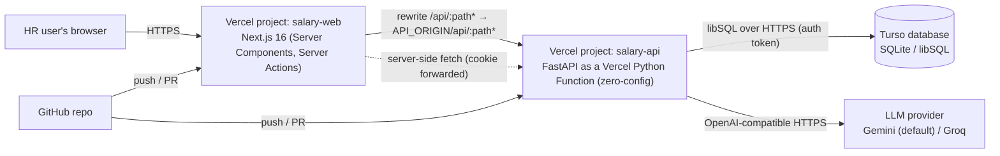

# 17 — Deployment

How the system is deployed for $0 on Vercel (web + API) and Turso (hosted SQLite), how environments and secrets are configured, and how we de-risk the deploy on day one.

- **Status:** Draft for review
- **Last updated:** 2026-10-24
- **Related docs:** [05-architecture.md](05-architecture.md) · [08-security-rbac.md](08-security-rbac.md) · [12-seed-data.md](12-seed-data.md) · [15-tooling-devex.md](15-tooling-devex.md) · [18-implementation-plan.md](18-implementation-plan.md) · [19-performance.md](19-performance.md) · [adr/0002-sqlite-everywhere-turso.md](adr/0002-sqlite-everywhere-turso.md) · [adr/0003-sync-sqlalchemy-serverless.md](adr/0003-sync-sqlalchemy-serverless.md) · [adr/0008-fastapi-auth-same-origin-rewrite.md](adr/0008-fastapi-auth-same-origin-rewrite.md) · [adr/0016-deploy-vercel-turso.md](adr/0016-deploy-vercel-turso.md)

---

## 1. Requirements and constraints

- The brief requires "fully functional deployed software".
- **$0 hosting** (user constraint), with nothing that expires while reviewers look. That rules out trial-based hosts: Fly.io (no free tier for new users) and Railway (30-day trial). Render free has no persistent disk and takes ~50 s to wake.
- Use the popular, well-documented options for a Next.js + FastAPI stack, with no self-managed servers (user constraint).
- **SQLite as the database** ([adr/0002-sqlite-everywhere-turso.md](adr/0002-sqlite-everywhere-turso.md)). Serverless platforms have no persistent disk, so production uses **Turso**, a hosted SQLite-compatible database (libSQL) with a free tier (≈ 5 GB storage, 500M row reads, 10M row writes per month, no sleeping). Figures are from third-party sources; verify at signup.

## 2. Topology



- **Two Vercel projects from one monorepo:** `salary-web` (root directory `frontend/`) and `salary-api` (root directory `backend/`). Each builds only when its own directory changes **(proposed: Vercel "Ignored Build Step" based on the path)**.
- **Same origin for the browser.** `*.vercel.app` is on the Public Suffix List, so `salary-web.vercel.app` and `salary-api.vercel.app` are *different sites*. The browser therefore only ever talks to the web origin; Next.js rewrites `/api/*` to the API project. The auth cookie is first-party (`SameSite=Lax`), which works in Safari and Firefox ([adr/0008-fastapi-auth-same-origin-rewrite.md](adr/0008-fastapi-auth-same-origin-rewrite.md)).
- **Server Components** call `API_ORIGIN` directly from the server and forward the user's cookie, so server-rendered pages include authenticated data.

## 3. Setup steps

### 3.1 Turso

1. Install the Turso CLI and log in (`turso auth login`).
2. Choose a region close to the Vercel function region (section 5).
3. Create the database from a pre-seeded file (section 6). Or create it empty: `turso db create salary-prod --location <region>`.
4. Create an auth token: `turso db tokens create salary-prod`. Store it **only** in Vercel env vars or a local `.env`; never commit it.
5. Get the URL: `turso db show salary-prod --url` → `libsql://salary-prod-<org>.turso.io`.
6. No preview DB: **preview deployments are cut from v1**. Only production is deployed; everything else is tested locally ([v1 scope](README.md#v1-scope-decided-2026-10-24-read-this-first)). In both Vercel projects, turn off preview builds for non-production branches (Git settings / Ignored Build Step).

### 3.2 Vercel API project (`salary-api`)

1. Import the GitHub repo into Vercel; set **Root Directory = `backend`**.
2. Framework preset: FastAPI (zero-config). Vercel detects the FastAPI `app` from the entrypoint, declared in `pyproject.toml` under `[tool.vercel]` **(exact key per Vercel docs at setup; TBD)**. The whole app becomes a single Vercel Function on Fluid compute.
3. Python version from `.python-version` / pyproject: 3.13, a version Vercel supports. Check at deploy time that Vercel reads it from the repo root, or add `backend/.python-version`.
4. Function region aligned with Turso (section 5).
5. Set the env vars (section 4).
6. Verify: `GET https://salary-api.vercel.app/api/v1/health` → `{"status":"ok","db":"ok"}`.

### 3.3 Vercel web project (`salary-web`)

1. Import the same repo as a second project; **Root Directory = `frontend`**; framework Next.js; install command `pnpm install --frozen-lockfile`.
2. Set `API_ORIGIN` to the API project's production URL (previews: the matching preview URL, see section 4).
3. Verify login end to end in Chrome **and Safari**.

### 3.4 Rewrite configuration

`frontend/next.config.ts` (outline):

```ts
const nextConfig = {
  async rewrites() {
    return [
      { source: "/api/:path*", destination: `${process.env.API_ORIGIN}/api/:path*` },
    ];
  },
};
export default nextConfig;
```

- The rewrite is the **only** proxying in Next.js: no business logic and no data transformation ([05-architecture.md](05-architecture.md)).
- `lib/api/server.ts` (used by Server Components and Server Actions) calls `API_ORIGIN` directly and sends the `session` cookie's JWT as `Authorization: Bearer <JWT>`.
- Login and file uploads use a client `fetch` through the rewrite, never a Server Action: a Server Action would receive FastAPI's `Set-Cookie` on the server instead of the browser, and Server Actions cap bodies at 1 MB by default.
- `proxy.ts` must not match `/api/*` or `/login`, or the login request gets redirected.

## 4. Environment variables

| Variable | Project | Local (`.env`) | CI | Preview | Production | Secret? |
|---|---|---|---|---|---|---|
| `APP_ENV` | api | `development` | `test` | — | `production` | no |
| `DATABASE_URL` | api | `sqlite:///./dev.db` | `sqlite://` (memory); `postgresql+psycopg://…` in the pg job | `sqlite+libsql://salary-preview-<org>.turso.io?secure=true` | `sqlite+libsql://salary-prod-<org>.turso.io?secure=true` | no (URL), token is |
| `DATABASE_AUTH_TOKEN` | api | — | — | — | prod token (passed via `connect_args`) | **yes** |
| `JWT_SECRET` | api | dev placeholder | test value | random 32+ bytes | random 32+ bytes | **yes** |
| `JWT_TTL_MINUTES` | api | `480` **(proposed)** | `5` | `480` | `480` | no |
| `COOKIE_SECURE` | api | `false` (http localhost) | `false` | `true` | `true` | no |
| `CORS_ORIGINS` | api | `http://localhost:3000` | — | — | empty (same origin via the rewrite) | no |
| `LLM_BASE_URL` | api | Gemini OpenAI-compatible URL | — (FakeLLM) | Gemini URL | Gemini URL | no |
| `LLM_MODEL` | api | Gemini Flash-class model **(TBD at build)** | — | same | same | no |
| `LLM_API_KEY` | api | optional; feature off if empty | — | optional | Gemini free key | **yes** |
| `ASK_RATE_LIMIT_PER_HOUR` | api | `20` | — | — | `20` | no |
| `SEED_ADMIN_PASSWORD`, `SEED_HR_PASSWORD`, `SEED_VIEWER_PASSWORD` | seed script | dev values | test values | demo values | demo values | **yes** |
| `API_ORIGIN` | web | `http://localhost:8000` | `http://localhost:8000` | API preview URL | API prod URL | no |

Rules:
- `.env.example` in each app lists every variable with safe placeholders and comments. Real `.env` files are git-ignored and **denied to Claude Code** ([16-claude-code-setup.md](16-claude-code-setup.md#71-permissions-outline)).
- **Production refuses to start** if `JWT_SECRET` is a known placeholder or shorter than 32 bytes, if `COOKIE_SECURE` isn't true, if `DATABASE_URL` points to a local file or memory, or if `CORS_ORIGINS` is set (pydantic-settings validation). `APP_ENV` is required, and the start-up error never shows the secret values it was given.
- Preview columns above are unused in v1: **preview deployments are cut**. (They would also hit Vercel Deployment Protection, which by default blocks unauthenticated requests to preview URLs, including the web → API rewrite.)
- Secrets are rotated by updating the Vercel env var and redeploying. A JWT secret rotation logs everyone out, which is acceptable.

## 5. Region alignment

Every API request makes several database round-trips. Turso and the Vercel function must be in the **same region**, or latency multiplies.

- **Proposed region:** a US-East pairing (Vercel `iad1` ↔ Turso `aws-us-east-1`), the most common and cheapest-latency choice for reviewers in mixed locations. Alternative: Mumbai (`bom1` ↔ `aws-ap-south-1`) if reviewers are primarily India-based. **TBD**, decided at the spike based on measured p95.
- Target: API p95 < **300 ms** for list and insight endpoints at 10k employees, warm ([19-performance.md](19-performance.md)). Cold start ≈ 1–2 s is accepted.

## 6. Migrations and seed against Turso

Migrations and seeding **never run inside a serverless function**: they are one-off operational tasks run from a developer machine or CI.

### 6.1 Initial load (fast path)

Inserting ~10k employees + ~30k salary records + ~40k components row-by-row over the network is slow. Instead:

```bash
make seed-turso
#   1. DATABASE_URL=sqlite:///./build/seed.db  alembic upgrade head
#   2. python -m salary_api.seed --seed 42 --employees 10000 --reset   (into build/seed.db)
#   3. prints the next command:
turso db create salary-prod --from-file ./build/seed.db --location <region>
```

The production database is then **byte-for-byte the deterministic seed**, already at the latest Alembic revision.

### 6.2 Subsequent schema changes

```bash
DATABASE_URL="sqlite+libsql://salary-prod-<org>.turso.io?secure=true" \
DATABASE_AUTH_TOKEN=... \
uv run alembic upgrade head
```

- Run from a laptop or a manually triggered GitHub Actions workflow (`migrate-prod.yml`, `workflow_dispatch`, secrets from GitHub environments) **(proposed)**.
- Order: **migrate first, then deploy the code** that needs the new schema. Migrations are written to be backward-compatible with the previous code version (additive columns, no renames in one step).
- Before migrating prod, create a Turso branch or snapshot, or rely on point-in-time restore (free tier ≈ 1 day; verify) as the backup.

### 6.3 Reset demo data

The demo DB can be restored to the pristine seed at any time by recreating it from the seed file (section 6.1). This is useful if reviewers' edits clutter the demo.

## 7. Day-1 deploy spike checklist (milestone 1)

The deploy is the riskiest unknown (young Turso Python driver, a two-project Vercel monorepo, the cookie through the rewrite), so it is proven **before** any feature work.

- [ ] `backend/` deploys to Vercel as a FastAPI function; `/api/v1/health` responds.
- [ ] Health does a real **write + read** against Turso through the SQLAlchemy libSQL dialect (e.g. inserts and reads a `healthcheck` row).
- [ ] Alembic `upgrade head` works against Turso from a laptop.
- [ ] `frontend/` deploys; a hello page calls `/api/v1/health` through the rewrite.
- [ ] A test endpoint sets an `HttpOnly; Secure; SameSite=Lax` cookie through the rewrite; a second request sees it, in **Chrome and Safari**.
- [ ] A Server Component on the web project fetches from `API_ORIGIN` server-side, forwarding the cookie.
- [ ] Measure the warm p95 of health and the cold-start time; record them in [19-performance.md](19-performance.md).
- [ ] Login via client fetch through the rewrite (not a Server Action): FastAPI's `Set-Cookie` reaches the browser.
- [ ] A 4 MB multipart upload passes through the rewrite to FastAPI.
- [ ] A 1,000-row bulk insert in one transaction against Turso: time it, and use the result to set the import row cap.
- [ ] The Python version Vercel actually uses matches `.python-version`, and the Turso driver installs from wheels.
- [ ] The Gemini project's real free-tier quota (RPM / RPD) is checked in AI Studio.
- [ ] **Decision gate:** if the libSQL driver is flaky (connection errors, unsupported features), switch to the **Neon Postgres fallback now** (section 8) and record it in a superseding ADR.

## 8. Fallback: Neon Postgres

Because the app uses the SQLAlchemy ORM with portable SQL, and CI already runs the integration suite against Postgres (`backend-pg` job), switching is a configuration change:

1. Create a Neon free project (0.5 GB is ample for ~10 MB of data) in the same region as the Vercel functions.
2. Set `DATABASE_URL=postgresql+psycopg://…` using Neon's **pooled** connection string (serverless-friendly); keep `NullPool` in the app ([adr/0003-sync-sqlalchemy-serverless.md](adr/0003-sync-sqlalchemy-serverless.md)).
3. `alembic upgrade head` against Neon, then run the seed directly (slower than the file import but fine, about a minute) or `pg_restore` from a dump.
4. Write ADR "Superseded 0002 for production: Neon Postgres" with the reasons.

## 9. Rollback

| Failure | Rollback |
|---|---|
| Bad web or API code deploy | Vercel **Instant Rollback** to the previous production deployment (dashboard or `vercel rollback`) |
| Bad migration | Restore Turso from the pre-migration branch or snapshot / point-in-time restore; redeploy the previous code |
| Corrupted or cluttered demo data | Recreate the DB from the deterministic seed file (section 6.3) |
| LLM provider outage or quota exhausted | Ask shows the friendly "busy / unavailable" state; switch `LLM_BASE_URL`/`LLM_MODEL`/`LLM_API_KEY` to Groq and redeploy, no code change ([10-ai-ask-design.md](10-ai-ask-design.md)) |
| Leaked secret | Rotate in Vercel/Turso, redeploy, invalidate sessions (rotate `JWT_SECRET`) |

## 10. Demo credentials policy

- The deployed demo contains **only synthetic seed data** ([12-seed-data.md](12-seed-data.md)).
- Three demo accounts: `admin@acme.example`, `hr@acme.example`, `viewer@acme.example`. Their passwords are set from env at seed time, are **not** committed defaults, and are shared in the README's "Demo" section and the submission email, so reviewers can see each role's behaviour (especially Viewer masking).
- Local development uses different dev passwords from `.env`.
- Production refuses known placeholder secrets (section 4). The demo accounts' passwords are not reused anywhere else.
- The demo can be reset at any time (section 6.3).

## 11. Monitoring and logs

- **Logs:** structlog JSON lines (`event`, `request_id`, `user_id`, `path`, `status`, `duration_ms`), visible in Vercel's runtime logs for the API project. No salary values or secrets are logged ([08-security-rbac.md](08-security-rbac.md)).
- **Request IDs:** generated by middleware (or taken from the `x-vercel-id` / `x-request-id` header) and returned in an `X-Request-ID` response header; problem+json errors include it, so a user-reported error can be traced.
- **Health:** `/api/v1/health` (DB round-trip) for manual checks and an optional free uptime ping **(proposed, e.g. a GitHub Actions cron hitting health daily)**.
- **Metrics:** Vercel's built-in function metrics (invocations, duration, errors). Next.js Speed Insights / Web Analytics on the free tier **(proposed, optional)**.
- **Audit:** business-level events are in `audit_events` and visible to Admin in the UI ([08-security-rbac.md](08-security-rbac.md)).
- **LLM usage:** each Ask writes an audit event (question, tools used, latency); the provider dashboard shows quota usage.
