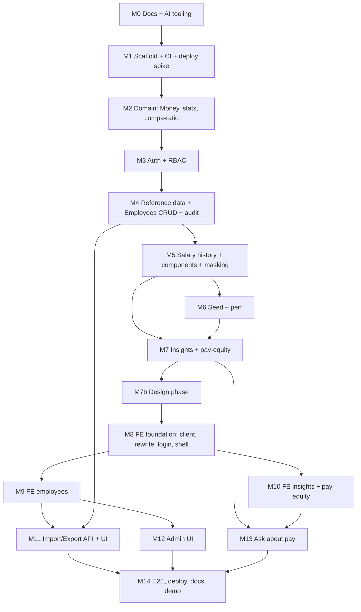

# 18 — Implementation Plan

The order in which we build the system: milestones 0–14 (plus 7b), each with a goal, tasks, deliverables, done-criteria, branch/PR and a user check-in. There is also a dependency graph and a risk register.

- **Status:** Draft for review
- **Last updated:** 2026-10-24
- **Related docs:** [01-prd.md](01-prd.md) · [02-requirements-one-pager.md](02-requirements-one-pager.md) · [05-architecture.md](05-architecture.md) · [06-data-model.md](06-data-model.md) · [07-api-spec.md](07-api-spec.md) · [14-testing-strategy.md](14-testing-strategy.md) · [15-tooling-devex.md](15-tooling-devex.md) · [16-claude-code-setup.md](16-claude-code-setup.md) · [17-deployment.md](17-deployment.md) · [demo-script.md](demo-script.md)

---

## 1. Working agreement

- **Spec before code.** Milestone 0 contains only documents and AI tooling. The first commit is `docs/02-requirements-one-pager.md`, as the brief requires a one-page requirements document before building.
- **TDD throughout.** Every behaviour starts with a failing test, with `test:` → `feat:` commit pairs ([14-testing-strategy.md](14-testing-strategy.md#2-tdd-workflow)).
- **One PR per milestone**, many small commits inside, **merged with a merge commit** (squash disabled) so the incremental history survives ([15-tooling-devex.md](15-tooling-devex.md#10-branches-prs-and-merge-policy)).
- **User check-in at the end of every milestone.** We review what was built, brainstorm the next milestone, and adjust the plan before starting it. Decisions made in check-ins become ADRs.
- **Definition of done** for every story: [14-testing-strategy.md](14-testing-strategy.md#11-definition-of-done-for-any-story).
- **Ordering principle:** de-risk first (deploy spike), then the domain core, then permissions (so every endpoint is built secure from the start), then features, then UI on a stable API, then AI last.

## 2. Dependency graph

## 3. Milestones

### M0: Docs and AI tooling
- **Goal:** requirements, design and decisions are written and reviewable before any code. AI guardrails are in place.
- **Tasks:**
  - `git init`, create the GitHub repo, protect `main` (merge commits only).
  - First commit: `docs/02-requirements-one-pager.md`.
  - The rest of `docs/` (this set): PRD, clarifications, research, architecture, data model, API spec, security, insights, AI, import/export, seed, UX, testing, tooling, Claude setup, deployment, this plan, performance, trade-offs, ADRs 0001–0018, AI workflow + prompt log, demo script.
  - `CLAUDE.md`, `AGENTS.md`, `backend/CLAUDE.md`, `frontend/CLAUDE.md` (stubs where folders don't exist yet), `.claude/settings.json`, `.claude/rules/*`, `.claude/skills/*`, `.claude/agents/reviewer.md`, `.claude/hooks/*`, `.mcp.json` ([16-claude-code-setup.md](16-claude-code-setup.md)).
  - Optionally send the clarification email ([03-clarifications.md](03-clarifications.md)).
- **Deliverables:** the docs and tooling committed.
- **Done when:** the user has reviewed and approved the docs; the ADRs are marked Accepted; skills appear in Claude Code.
- **Branch/PR:** `m00-docs-and-ai-tooling` (or direct to `main` before protection is enabled **(proposed)**).
- **Check-in:** walk through the docs; confirm the scope and any answers from Incubyte.

### M1: Scaffold, CI and deploy spike
- **Goal:** both apps run locally with all quality tooling, CI is green, and **the production deploy path is proven on day 1**.
- **Tasks:**
  - Backend: `uv init`, Python 3.14, FastAPI app factory, `/api/v1/health` (DB round-trip), pydantic-settings config, structlog + request-id middleware, problem+json error handler, Alembic init, ruff/pyright/pytest config, first test (`test_health_returns_ok`).
  - Frontend: `create-next-app@latest` (TS, App Router, Tailwind v4), shadcn init, ESLint flat config + Prettier, Vitest + RTL + MSW setup, Playwright init, knip; hello page calling health.
  - Repo: Makefile, lefthook, `.editorconfig`, `.gitattributes`, `.gitignore`, `.env.example` files, `compose.yaml` (Postgres), `.nvmrc`, `.python-version`, README quick start.
  - GitHub: `ci.yml` (backend, backend-pg, frontend, contract, security; e2e stub), `codeql.yml`, `dependabot.yml`, PR and issue templates.
  - **Deploy spike** ([17-deployment.md](17-deployment.md#7-day-1-deploy-spike-checklist-milestone-1)): two Vercel projects, Turso DB, libSQL driver write+read, rewrite, cookie in Safari, server-side fetch, preview wiring, measured latency.
- **Deliverables:** `make setup && make dev` works; CI green; a live hello page + health on Vercel.
- **Done when:** every spike checklist item passes, or the Neon fallback is taken and recorded in an ADR. The resolved tool versions are recorded in [adr/0017-toolchain.md](adr/0017-toolchain.md).
- **Branch/PR:** `m01-scaffold-ci-deploy-spike`.
- **Check-in:** spike results, chosen region, any toolchain surprises.

### M2: Domain core (pure TDD)
- **Goal:** the business maths is correct and fully unit-tested with no I/O.
- **Tasks:** `domain/currency.py` (ISO 4217 exponents for the seeded currencies + validation), `domain/money.py` (integer minor units, no floats, from/to major, currency mismatch), FX conversion with dated `Decimal` rates, `domain/stats.py` (min/max/mean/median/P25/P75, empty and single cases), `domain/pay_equity.py` (cohort key, compa-ratio, flags), total-comp calculation, hypothesis properties.
- **Deliverables:** `backend/src/salary_api/domain/*` + `tests/unit/domain/*`.
- **Done when:** all domain behaviours in [14-testing-strategy.md](14-testing-strategy.md#51-domain-pure-no-io) are covered; branch coverage on the domain ≥ 95% **(proposed)**; the commit history shows red/green pairs.
- **Branch/PR:** `m02-domain-core`.
- **Check-in:** review the money and stats rules (rounding mode, percentile method, compa-ratio boundaries).

### M3: Auth and RBAC
- **Goal:** login works and every later endpoint can declare a permission from day one.
- **Tasks:** `users` model + migration; pwdlib argon2 hashing; PyJWT issue/verify; `POST /auth/login` (httpOnly cookie), `POST /auth/logout`, `GET /auth/me` (user, role, permissions, feature flags); `core/permissions.py` (role → permission map: EMPLOYEE_READ, EMPLOYEE_WRITE, SALARY_READ, SALARY_WRITE, INSIGHTS_READ, EXPORT, IMPORT, ASK, USER_ADMIN, FX_ADMIN, REFERENCE_ADMIN, AUDIT_READ); `require_permission` dependency; the authz matrix test harness + route-introspection guard; prod secret validation.
- **Deliverables:** the auth module, permissions module, matrix test.
- **Done when:** the auth tests in [14-testing-strategy.md](14-testing-strategy.md#53-api-and-authorization-matrix) pass; cookie flags verified; no user enumeration.
- **Branch/PR:** `m03-auth-rbac`.
- **Check-in:** confirm the permission mapping per role ([08-security-rbac.md](08-security-rbac.md)).

### M4: Reference data, Employees CRUD and audit
- **Goal:** HR can create, find, view, edit, terminate and reactivate employees safely.
- **Tasks:** `countries`, `departments`, `job_roles` models + seed fixtures; `employees` model (with `search_text`, `version`) + migration + indexes; `audit_events` model + service helper (same transaction); endpoints `GET/POST /employees`, `GET/PATCH /employees/{id}`, `POST /employees/{id}/terminate|reactivate`; list with pagination (default page size 25), search by name/code/email, filters (country, department, job role, level, status, employment type, currency), allow-listed sort; optimistic locking → 409; problem+json validation; reference read endpoints.
- **Deliverables:** reference, employees and audit modules; matrix entries.
- **Done when:** service + API tests pass; every mutation writes exactly one audit event; Unicode search works ("müller").
- **Branch/PR:** `m04-employees-crud`.
- **Check-in:** list and filter behaviour, field validation rules.

### M5: Salary history, components and masking
- **Goal:** salary is recorded as an append-only history with components; confidential pay is protected.
- **Tasks:** `salary_records` (with role/level snapshot, reason enum `HIRE`/`PROMOTION`/`MERIT`/`MARKET_ADJUSTMENT`/`CORRECTION`, no future dates) and `salary_components` (ALLOWANCE / BONUS_TARGET) + migration; `POST /employees/{id}/salary-changes` (append + denormalize current base/total + audit, one transaction); `GET /employees/{id}/salary-history`; masking for principals without SALARY_READ in list and detail; total comp on the employee; `fx_rates` model + read endpoint.
- **Deliverables:** the salaries module + masking tests.
- **Done when:** a Viewer never receives individual salary values in any endpoint; the history is immutable; denormalized values always match the latest record.
- **Branch/PR:** `m05-salary-history`.
- **Check-in:** confirm the component types and history display needs.

### M6: Seed and performance baseline
- **Goal:** a deterministic, realistic dataset of 10,000 employees with a documented demo story, loaded fast.
- **Tasks:** `seed/seed_config.py` (countries/shares, departments, job roles, levels, bands, components), `seed/generator.py` (`random.Random(seed)`, Faker per locale, history generation, planted outliers + the DE Customer Success gap), `seed/cli.py` (`--seed --employees --reset`), bulk Core inserts in chunks of 1,000, demo users from env, static FX snapshot (as_of 2026-10-01), `make seed`, `make seed-turso`, `seed/README.md`; determinism and story tests; measure seed time and query timings.
- **Deliverables:** the seed package, [19-performance.md](19-performance.md) baseline numbers.
- **Done when:** seed < 5 s locally (target); determinism test passes; the demo story is verifiable by test.
- **Branch/PR:** `m06-seed`.
- **Check-in:** sanity-check the distributions; agree the demo story wording.

### M7: Insights and pay-equity
- **Goal:** HR can answer "how does the org pay people" with correct, currency-aware numbers.
- **Tasks:** `GET /insights/overview`, `by-department`, `by-job-title`, `distribution`, `department-cost`, `top-earners` (SALARY_READ only), `raises`, `pay-equity` (cohorts + flagged employees); `comp=base|total` parameter; full-time default with an override; USD conversion with `fx_as_of` in every response; small-group suppression for principals without SALARY_READ; index tuning; timing checks.
- **Deliverables:** the insights module, tests, perf numbers.
- **Done when:** the metric definitions in [09-insights-pay-equity.md](09-insights-pay-equity.md) are covered by tests; p95 < 300 ms locally at 10k; the seeded DE gap is visible in pay-equity.
- **Branch/PR:** `m07-insights-pay-equity`.
- **Check-in:** review the numbers on the seeded data; decide the chart content for the design phase.

### M7b: Design phase
- **Goal:** screens are designed and frozen before frontend code ([adr/0018-design-workflow.md](adr/0018-design-workflow.md)).
- **Tasks:** Claude Design canvases for 5 key screens (Insights dashboard, Employee list, Employee detail + salary timeline, Import preview, Ask), 2 options each; the user picks; write `docs/design/DESIGN.md` (tokens, typography with tabular numerals, spacing, components, currency labelling, light/dark, anti-patterns) + screenshots; mirror to `.claude/rules/design.md`; review and install the Impeccable skill.
- **Deliverables:** `docs/design/*`, the design rule, the Impeccable install recorded in the prompt log.
- **Done when:** the user has approved one design per screen.
- **Branch/PR:** `m07b-design`.
- **Check-in:** this is the check-in, where the designs are selected.

### M8: Frontend foundation
- **Goal:** a typed, authenticated app shell following DESIGN.md.
- **Tasks:** `make api-sync` + openapi-fetch clients (`lib/api/server.ts` with cookie forwarding, `lib/api/client.ts`); the `/api` rewrite; `proxy.ts` auth redirect; login page (Server Action); app shell (navigation per permission, user menu, theme toggle); `lib/money.ts` formatting (minor units, currency exponent, monthly toggle); error and empty states; MSW typed handlers.
- **Deliverables:** the frontend foundation + unit tests.
- **Done when:** login/logout works locally and on preview (Safari included); nav adapts to role; the contract job passes.
- **Branch/PR:** `m08-fe-foundation`.
- **Check-in:** UX of the shell and login.

### M9: Frontend employees
- **Goal:** the full employee management experience.
- **Tasks:** employee list (TanStack Table, server-side pagination/sort, nuqs URL filters, search, masked cells for Viewer); create/edit forms (react-hook-form + zod, controlled job-role list, 409 conflict handling); employee detail with the salary timeline ("L2 → L3, Promotion, +12%"); "Record salary change" dialog with components; terminate/reactivate; Impeccable audit.
- **Deliverables:** pages under `/employees`, component tests, Playwright flows 1 and 3.
- **Done when:** the e2e smoke for search → raise passes; Viewer masking verified in the UI.
- **Branch/PR:** `m09-fe-employees`.
- **Check-in:** usability walkthrough.

### M10: Frontend insights and pay-equity
- **Goal:** the insights dashboard and pay-equity view.
- **Tasks:** `/insights` (overview KPIs, by-country table with local + USD figures and the FX date, by department, by job title, distribution histogram, department cost, raises, top/bottom earners where permitted); base/total and annual/monthly toggles; full-time default toggle; `/insights/pay-equity` (cohort table with P25/median/P75, compa-ratio flags, drill-down to employees); suppressed-group display ("—") for Viewer; Impeccable audit.
- **Deliverables:** insight pages + tests; Playwright flow 2.
- **Done when:** the numbers match the API; currency context is always visible; the DE story is discoverable in the UI.
- **Branch/PR:** `m10-fe-insights`.
- **Check-in:** "can the HR manager answer their questions?" walkthrough.

### M11: Import and export
- **Goal:** move data in and out of Excel safely.
- **Tasks:** export `GET /employees/export?format=csv|xlsx` (filters, role-aware columns, formula neutralisation, audit); import pipeline (CSV and XLSX parsers → shared validator → duplicate detection in-file and vs DB → `import_jobs` dry-run report → commit all-or-nothing → audit); template download; caps (4 MB, row cap); `/employees/import` UI (upload → preview with row errors → commit); Impeccable audit.
- **Deliverables:** the imports/exports modules + UI; fixtures `import_sample.csv/.xlsx`; Playwright flow 4.
- **Done when:** the import tests in [14-testing-strategy.md](14-testing-strategy.md) (section 5.4) pass, including CSV/XLSX parity and rollback.
- **Branch/PR:** `m11-import-export`.
- **Check-in:** import UX and error messages.

### M12: Admin UI
- **Goal:** administrators manage users, FX rates and countries, and can review the audit log.
- **Tasks:** admin APIs (`/users` with role assignment, `/fx-rates`, `/countries`, `/audit-events` with filters); admin pages under `/admin/*`; the audit log viewer (actor, action, entity, diff, time; filter by actor, action and date); Playwright flow 5.
- **Deliverables:** admin module + pages.
- **Done when:** only ADMIN can reach these (matrix + UI); an FX change visibly changes USD insights and is audited.
- **Branch/PR:** `m12-admin`.
- **Check-in:** admin scope sanity.

### M13: Ask about pay
- **Goal:** HR can ask questions in plain English and get grounded, permission-safe answers ([10-ai-ask-design.md](10-ai-ask-design.md)).
- **Tasks:** `LLMClient` protocol + an OpenAI-compatible adapter (Gemini default, Groq alternative via env); `FakeLLM`; tool registry over the insight services, with permission filtering + executor re-check; enum-validated args; compact system prompt with reference data; loop cap of 4; per-user rate limit from `audit_events`; 429/unavailable handling; feature flag; `POST /ask`; `/ask` page (spinner, multi-turn history client-side, figures, "How I got this", "View in dashboard" link **(if time)**); eval set `docs/ai/evals/ask.yaml` + `make eval-ask`; model comparison results.
- **Deliverables:** the ask module + UI + eval results.
- **Done when:** the FakeLLM tests pass; eval ≥ 80% on the default provider **(proposed threshold)**; a Viewer asking for top earners gets an access message; the follow-up question works.
- **Branch/PR:** `m13-ask-about-pay`.
- **Check-in:** review the eval results and the provider choice.

### M14: Hardening, deploy and submission
- **Goal:** a polished, deployed, documented submission.
- **Tasks:** complete the Playwright suite (desktop + phone, axe); `/code-review` and `/security-review` passes and fixes; production seed via `make seed-turso`; production env + secrets; final deploy; README (quick start, demo URL, demo credentials, docs index, architecture summary); update [19-performance.md](19-performance.md) with production measurements; finalize [20-trade-offs.md](20-trade-offs.md) and the prompt log; record the 3–5 min demo video per [demo-script.md](demo-script.md); tag `v1.0.0` + GitHub Release; reply to the Incubyte email with the repo link.
- **Deliverables:** live URL, video, tag.
- **Done when:** every item in the PRD's success criteria is met ([01-prd.md](01-prd.md)); CI green on `main`; a fresh clone → `make setup && make dev` works.
- **Branch/PR:** `m14-release`.
- **Check-in:** final review before sending.

## 4. Risk register

| # | Risk | Likelihood | Impact | Mitigation | Owner milestone |
|---|---|---|---|---|---|
| R1 | Turso Python/SQLAlchemy driver is immature (original repo archived Jun 2025; new binding) | Medium | High | Day-1 spike with real write/read; ORM + `backend-pg` CI job make the **Neon fallback a URL change** | M1 |
| R2 | Two-project Vercel monorepo + preview URL wiring is fiddly | Medium | Medium | Proven in the spike; stable preview alias fallback | M1 |
| R3 | Cookie through the rewrite fails in Safari | Low | High | Same-origin rewrite design; explicit Safari check in the spike | M1 |
| R4 | Vercel function limits (4.5 MB body, timeouts) break import/export | Low | Medium | 4 MB upload cap; 10k CSV ≈ 1.5 MB; dry-run stored in `import_jobs`; streaming export | M11 |
| R5 | Free LLM tier limits (Groq TPM; Gemini quotas) or a provider outage | Medium | Medium | Compact prompts, loop cap, per-user rate limit, friendly 429; switch provider via env | M13 |
| R6 | Gemini free tier may use prompts for training | Certain (policy) | Low for synthetic data | Synthetic data only; aggregates by default; ADR notes a paid or no-training tier for real use | M13 |
| R7 | LLM gives wrong numbers (hallucination / arithmetic) | Medium | High | Tools compute (incl. `compare_groups`), the model never does maths; answers cite tools; eval set ≥ 80% | M13 |
| R8 | Scope creep (bonus components, import, AI, admin) delays core quality | Medium | High | Fixed milestone order, core first; AI last; check-ins can cut scope; out-of-scope list in the requirements | all |
| R9 | Pyright strict + SQLAlchemy/Pydantic typing friction slows TDD | Medium | Low | Strict on `src/` only; targeted `# pyright: ignore[...]` with a reason; typed `Mapped[]` models | M2–M5 |
| R10 | Seed too slow over the network to Turso | High (if row-by-row) | Low | Build locally → `turso db create --from-file` | M6 |
| R11 | SQLite vs Postgres dialect drift | Low | Medium | Portable SQL; stats in Python; the `backend-pg` job on every PR | M1+ |
| R12 | Reviewer accesses the demo after free-tier resets / DB clutter | Low | Medium | No-expiry free tiers; reset-from-seed procedure | M14 |
| R13 | AI-generated UI looks generic ("AI slop") | Medium | Medium | Design phase first; DESIGN.md rule; Impeccable audit per screen | M7b–M12 |
| R14 | Commit history loses its TDD story (squash, giant commits) | Low | High | Squash disabled; `/commit` skill; lefthook message check; small cycles | all |
| R15 | Package churn ("latest" moves during the project) | Medium | Low | Lockfiles; Dependabot monthly grouped; version policy | M1 |
| R16 | Unclear requirements from the brief (currency, insights expected) | Medium | Medium | Clarification email; documented assumptions; adjust at check-ins | M0 |

## 5. Rough effort guide (proposed)

| Milestone | Relative size |
|---|---|
| M0, M7b, M12 | S |
| M1, M2, M3, M6, M8, M14 | M |
| M4, M5, M7, M9, M10, M11, M13 | M–L |

Sizes are relative, for sequencing and check-in planning only. No calendar commitment is implied beyond "submit as early as quality allows" (the hiring email notes faster submissions are prioritized).
