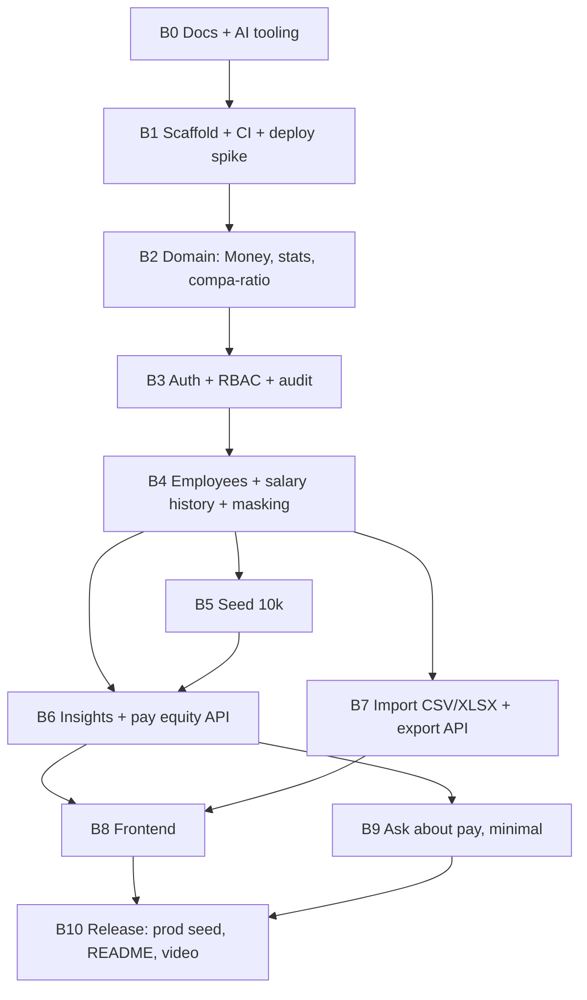

# 18 — Implementation Plan

The order in which we build the system in a **1–2 day budget**: ten build blocks over two days, each with tasks and done-criteria, plus a further-cut order, a dependency graph and a risk register. The v1 scope (what was cut and why) is in the [docs README](README.md#v1-scope-decided-2026-10-24-read-this-first).

- **Status:** Draft for review
- **Last updated:** 2026-10-24
- **Related docs:** [00-assessment-brief.md](00-assessment-brief.md) · [01-prd.md](01-prd.md) · [02-requirements-one-pager.md](02-requirements-one-pager.md) · [05-architecture.md](05-architecture.md) · [06-data-model.md](06-data-model.md) · [07-api-spec.md](07-api-spec.md) · [14-testing-strategy.md](14-testing-strategy.md) · [15-tooling-devex.md](15-tooling-devex.md) · [16-claude-code-setup.md](16-claude-code-setup.md) · [17-deployment.md](17-deployment.md) · [demo-script.md](demo-script.md)

---

## 1. Working agreement

- **Spec before code.** The docs and AI tooling come first. The first commit is `docs/02-requirements-one-pager.md`, as the brief requires a one-page requirements document before building.
- **TDD throughout.** Every behaviour starts with a failing test, with `test:` → `feat:` commit pairs ([14-testing-strategy.md](14-testing-strategy.md#2-tdd-workflow)). Commits are made as the work happens, never split up afterwards.
- **One short branch per block**, many small commits inside, merged with a merge commit (squash disabled) so the incremental history survives ([15-tooling-devex.md](15-tooling-devex.md#10-branches-prs-and-merge-policy)).
- **Two check-ins:** at the end of day 1 (spike result, backend state, day-2 cuts) and before submission.
- **Definition of done** for every story: [14-testing-strategy.md](14-testing-strategy.md#11-definition-of-done-for-any-story).
- **Ordering principle:** de-risk first (deploy spike), then the domain core, then permissions and audit (so every endpoint is built secure and audited from the start), then features, then UI on a stable API, then AI last.

## 2. Dependency graph

## 3. Build blocks

| Day | Block | Hours (est.) |
|---|---|---|
| 1 | B1 Scaffold + CI + deploy spike | 1.5 |
| 1 | B2 Domain core | 1.5 |
| 1 | B3 Auth, RBAC and audit | 1.5 |
| 1 | B4 Employees + salary history + masking | 2.5 |
| 1 | B5 Seed 10k | 1 |
| 2 | B6 Insights + pay equity API | 2 |
| 2 | B7 Import (CSV + XLSX) + export | 3.5–4.5 |
| 2 | B8 Frontend | 4–5 |
| 2 | B9 Ask about pay (minimal) | 1.5 |
| 2 | B10 Release | 1.5 |

Day 2 is the heavy day. If it overruns, apply the cuts in §3a.

### B0: Docs and AI tooling (done before day 1)
- **Tasks:** the `docs/` set; `CLAUDE.md`, `AGENTS.md`, `.claude/settings.json`, `.claude/rules/*`, `.claude/skills/*`, `.claude/agents/reviewer.md`, `.claude/hooks/*`, `.mcp.json` ([16-claude-code-setup.md](16-claude-code-setup.md)).
- **Done when:** the docs reflect the v1 scope; skills appear in Claude Code.

### B1: Scaffold, CI and deploy spike (day 1)
- **Tasks:**
  - Backend: `uv init`, FastAPI app factory, `/api/v1/health` (DB round-trip), pydantic-settings config, request-id middleware, problem+json error handler, Alembic init, ruff/pyright/pytest config, first test (`test_health_returns_ok`).
  - Frontend: `create-next-app@latest` (TS, App Router, Tailwind v4), shadcn init, ESLint flat config + Prettier, Vitest + RTL setup; hello page calling health.
  - Repo: Makefile, lefthook, `.editorconfig`, `.gitignore`, `.env.example` files, `.python-version` (pinned to a version Vercel supports), README quick start.
  - GitHub: one `ci.yml` (lint, typecheck, backend tests, frontend tests, contract drift, gitleaks).
  - **Deploy spike** ([17-deployment.md](17-deployment.md#7-day-1-deploy-spike-checklist-milestone-1)), **production only, no previews**: two Vercel projects, Turso DB, libSQL driver write + read, rewrite, login cookie through the rewrite in Chrome and Safari, Server Component fetch with the forwarded cookie, a 4 MB upload through the rewrite, a 1,000-row bulk insert timing, measured latency.
- **Done when:** `make setup && make dev` works; CI green; a live hello page + health on Vercel; every spike item passes **or** the Neon fallback is taken and recorded in an ADR.

### B2: Domain core, pure TDD (day 1)
- **Tasks:** `domain/currency.py` (ISO 4217 exponents for the seeded currencies), `domain/money.py` (integer minor units, no floats, from/to major, currency mismatch), FX conversion with dated `Decimal` rates, `domain/stats.py` (min/max/mean/median/P25/P75, empty and single cases), `domain/pay_equity.py` (compa-ratio vs band midpoint, flags, department rollup), total-comp calculation, hypothesis properties.
- **Done when:** the domain behaviours in [14-testing-strategy.md](14-testing-strategy.md#51-domain-pure-no-io) are covered; the history shows red/green pairs.

### B3: Auth, RBAC and audit (day 1)
- **Tasks:** `users` and `audit_events` models + migration; audit helper (same transaction as the change); pwdlib argon2; PyJWT; `POST /auth/login` (httpOnly cookie), `POST /auth/logout`, `GET /auth/me`; `core/permissions.py` (role → permission map per [08-security-rbac.md](08-security-rbac.md)); `require_permission`; login failure limit (counted from `audit_events`); authz matrix test harness + route-introspection guard; prod secret validation.
- **Done when:** the auth tests in [14-testing-strategy.md](14-testing-strategy.md#53-api-and-authorization-matrix) pass; cookie flags verified; no user enumeration; login success and failure are audited.

### B4: Employees, salary history and masking (day 1)
Employees and salary records are built together because creating an employee writes its `HIRE` salary record in the same transaction ([06-data-model.md](06-data-model.md) §6.1).
- **Tasks:** `countries`, `departments`, `job_roles`, `pay_bands`, `fx_rates` models + fixtures; `employees` (with `search_text`, `version`), `salary_records`, `salary_components` + migration + indexes; `GET/POST /employees`, `GET/PATCH /employees/{id}`, `POST /employees/{id}/terminate|reactivate`, `POST /employees/{id}/salary-changes`, `GET /employees/{id}/salary-history`; list pagination, search, filters, allow-listed sort; optimistic locking → 409; **salary currency must equal the country's currency**; Viewer masking in list and detail; reference read endpoints.
- **Done when:** service + API tests pass; every mutation writes exactly one audit event; history is append-only; the denormalized current salary always matches the latest record; a Viewer never receives an individual salary; Unicode search works ("müller").

### B5: Seed 10k (day 1)
- **Tasks:** `seed_config.py`, `generator.py` (`random.Random(seed)`, Faker per locale, history, planted outliers + the DE Customer Success gap), `cli.py`, bulk Core inserts, demo users from env, static FX snapshot, `make seed`, `make seed-turso`.
- **Done when:** seed of 10k runs locally in seconds; the determinism test passes; the demo story is verifiable by test.

### B6: Insights and pay equity API (day 2)
- **Tasks:** `GET /insights/overview`, `by-department`, `by-job-title`, `department-cost`, `top-earners` (SALARY_READ only), `pay-equity` (cohorts, department rollup, cohort drill-down); `comp=base|total`; full-time default with an override; USD conversion with `fx_as_of`; small-group suppression for callers without `SALARY_READ`.
- **Privacy and correctness rules from the design review (each one rule + one test):**
  - [ ] `min` and `max` are `null` for callers without `SALARY_READ` (each is one person's exact salary).
  - [ ] `compare_groups` (and any difference) is computed from already-suppressed values; `null` if either side is suppressed.
  - [ ] Complementary suppression: when a Viewer response hides one group, also hide the next-smallest, so totals minus visible groups can't reveal it.
  - [ ] Compa-ratio is `null` for non-`FULL_TIME` employees (part-time pay isn't FTE-normalised).
- **Done when:** the metric definitions in [09-insights-pay-equity.md](09-insights-pay-equity.md) for these endpoints are covered by tests; the seeded DE gap is visible in the pay-equity rollup; the four rules above have tests.

### B7: Import (CSV + XLSX) and export (day 2)
- **Tasks:** export `GET /employees/export?format=csv|xlsx` (filters, role-aware columns, formula neutralisation, audit); import pipeline per [11-import-export.md](11-import-export.md): CSV and XLSX parsers → shared validator → duplicate detection (in file and vs DB) → `import_jobs` dry-run report → all-or-nothing commit → audit; template download; caps (4 MB, row cap set from the spike's bulk-insert timing).
- **Done when:** the import tests in [14-testing-strategy.md](14-testing-strategy.md) §5.4 pass, including CSV/XLSX parity and rollback.

### B8: Frontend (day 2)
- **Tasks:** `make api-sync` + openapi-fetch clients; the `/api` rewrite; `proxy.ts` (matcher excludes `/api` and `/login`); login page (client fetch through the rewrite, so FastAPI's cookie reaches the browser); app shell with permission-aware nav; `lib/money.ts`; employee list (server-side paging and sort, nuqs URL filters, masked cells for Viewer); employee detail with salary timeline; record-salary-change form; create/edit/terminate; insights page; pay-equity page; import page (upload via client fetch → preview with row errors → commit); export button. shadcn defaults guided by the frontend-design skill.
- **Mobile:** every screen is built mobile-first and fully usable on a phone ([13-frontend-ux.md](13-frontend-ux.md) §8): tables become card lists, filters open in a bottom sheet, side sheets go full screen.
- **Done when:** the main flows work locally and in production (Safari included) at 390 px and 1440 px; Viewer masking verified in the UI; one Playwright smoke flow (HR login → search → record raise) passes at desktop and phone sizes.

### B9: Ask about pay, minimal (day 2, if time allows)
- **Tasks:** `LLMClient` protocol + OpenAI-compatible adapter (Gemini); `FakeLLM`; about 5 read-only tools over the insight services with permission filtering + executor re-check; loop cap; per-user rate limit; error handling; feature flag; `POST /ask`; `/ask` page; about 5 eval questions run once.
- **Done when:** the FakeLLM tests pass; a Viewer asking for top earners gets an access message.

### B10: Release (day 2)
- **Tasks:** production seed via `make seed-turso`; production env + secrets; final deploy; root README (what it is, live URL, demo credentials, run locally, v1 scope and future work, docs index); prompt log updated; demo video per [demo-script.md](demo-script.md); tag `v1.0.0`; reply to the Incubyte email with the repo link.
- **Done when:** CI green on `main`; a fresh clone → `make setup && make dev` works; the deployed URL works for all three demo roles.

## 3a. Further cuts if day 2 overruns

Cut **from the top first**. Each cut is logged in the prompt log and in the root README's "Not done / future work" section, because judgment about scope is itself graded.

| Order | Cut / defer | Keep instead |
|---|---|---|
| 1 | Ask about pay (B9) | The documented design ([10-ai-ask-design.md](10-ai-ask-design.md)) as future work |
| 2 | XLSX **import** | CSV import with dry-run; XLSX export stays (cheap) |
| 3 | Total-comp toggle in the UI | Base pay everywhere in the UI; total comp stays in the API |
| 4 | The Playwright smoke flow | API and component tests |

Already cut from v1 (not in this plan): see the [docs README](README.md#v1-scope-decided-2026-10-24-read-this-first).

**Never cut:**
- TDD and the commit history
- the requirements doc and the rest of the docs
- the 10k seed
- employees + salary history
- currency-correct insights
- pay equity
- RBAC with Viewer masking
- the deployed app
- the video demo

## 4. Risk register

| # | Risk | Likelihood | Impact | Mitigation | Block |
|---|---|---|---|---|---|
| R1 | Turso Python/SQLAlchemy driver is immature (original repo archived Jun 2025; new binding) | Medium | High | Day-1 spike with real write/read; the ORM makes the **Neon fallback a URL change** | B1 |
| R2 | Two-project Vercel monorepo is fiddly | Medium | Medium | Proven in the spike; production only, no preview wiring | B1 |
| R3 | Cookie through the rewrite fails in Safari | Low | High | Same-origin rewrite design; login via client fetch; explicit Safari check in the spike | B1 |
| R4 | Vercel function limits (4.5 MB body, timeouts) break import/export | Low | Medium | 4 MB upload cap; 10k CSV ≈ 1.5 MB; dry-run stored in `import_jobs`; row cap set from the spike's bulk-insert timing | B7 |
| R5 | Free LLM tier limits (Gemini quotas) or a provider outage | Medium | Medium | Check the real quota in the spike; compact prompts, loop cap, per-user rate limit, friendly 429 | B9 |
| R6 | Gemini free tier may use prompts for training | Certain (policy) | Low for synthetic data | Synthetic data only; aggregates by default; ADR notes a paid or no-training tier for real use | B9 |
| R7 | LLM gives wrong numbers (hallucination / arithmetic) | Medium | High | Tools compute, the model never does maths; answers cite tools; small eval set | B9 |
| R8 | Day 2 overruns | High | High | Further-cut order (§3a); end-of-day-1 check-in decides early | all |
| R9 | Pyright strict + SQLAlchemy/Pydantic typing friction slows TDD | Medium | Low | Strict on `src/` only; targeted `# pyright: ignore[...]` with a reason; typed `Mapped[]` models | B2–B4 |
| R10 | Seed too slow over the network to Turso | High (if row-by-row) | Low | Build locally → `turso db create --from-file` | B5 |
| R11 | Reviewer accesses the demo after free-tier resets / DB clutter | Low | Medium | No-expiry free tiers; reset-from-seed procedure | B10 |
| R12 | AI-generated UI looks generic ("AI slop") | Medium | Medium | shadcn defaults, frontend-design skill, one consistent layout; no design phase in v1 | B8 |
| R13 | Commit history loses its TDD story (squash, giant commits) | Low | High | Squash disabled; `/commit` skill; lefthook message check; small cycles | all |
| R14 | Package churn ("latest" moves during the project) | Low | Low | Lockfiles; version policy | B1 |
| R15 | Unclear requirements from the brief (currency, insights expected) | Medium | Medium | Clarification email; documented assumptions | B0 |
